# DeepSeek Pocket

[](https://github.com/nagatoquin33/deepseek-pocket/actions/workflows/build-apk.yml)
[](https://github.com/nagatoquin33/deepseek-pocket/releases/latest)
[](LICENSE)
[](#10-compatibility)
[](https://nagatoquin33.github.io/deepseek-pocket/)

English · [中文](README.md)

> This page mirrors the [Chinese README](README.md), which is the primary document when the two differ.

DeepSeek on your phone, **running on your own open-platform (platform.deepseek.com) quota**.
Deep thinking, smart search with citations, voice input and read-aloud, multiple sessions, prompt blocks and usage stats — all of it.
No build step, no frontend framework: Android is a native shell that talks to the API directly, and the browser gets a LAN server run by Node.

> Unofficial client, not affiliated with DeepSeek. The UI is redrawn after the official app 2.8 and the whale icon is the official colour version; personal use only.

---

## 30-second start

| I want to… | How |
| --- | --- |
| **Just install the APK** | Download `DeepSeekPocket-*.apk` from [Releases](https://github.com/nagatoquin33/deepseek-pocket/releases/latest), install it, then paste your API key on the sign-in page |
| **See what it looks like first** | Official demo: <https://cdn.deepseek.com/chat-demo>; or the [screenshots](#1-what-it-looks-like) below |
| **Run it offline (no cost)** | `node server.mjs --mock`, open the printed address on your phone or desktop, tap "offline demo mode" |
| **Build the APK myself** | `bash android/build.sh` (Linux/macOS/CI) or `powershell -File android/build.ps1` (Windows) |
| **Use it in a browser / as a PWA** | `node server.mjs`, open the printed address on the same Wi-Fi, then "Add to Home Screen" in Safari/Chrome |

> Docs: [Screenshots](#1-what-it-looks-like) · [Features](#2-features) · [Quick start](#3-quick-start) · [Sign-in](#4-one-tap-sign-in-and-quota) · [Billing](#5-billing) · [API map](#6-api-map) · [Architecture](docs/ARCHITECTURE.md) · [Development](docs/DEVELOPMENT.md) · [Releasing](docs/RELEASING.md) · [Architecture](#7-architecture) · [Privacy](#8-data-and-privacy) · [Development and CI](#9-development-testing-and-ci) · [Compatibility](#10-compatibility) · [Limits](#11-known-limitations) · [FAQ](docs/FAQ.md) · [Changelog](CHANGELOG.md) · [API details](docs/API-MAPPING.md) · [Contributing](CONTRIBUTING.md) · [Security](SECURITY.md)

---

## 1. What it looks like

Redrawn after the official app 2.8: the home screen "Hi! What's on your mind today?", the three-part top bar, the input card "Message or hold to talk", grouped white settings cards, a minimal message layout.

| Home | Chat (thinking / search / citations) | Deep-thinking expanded |
| --- | --- | --- |
| 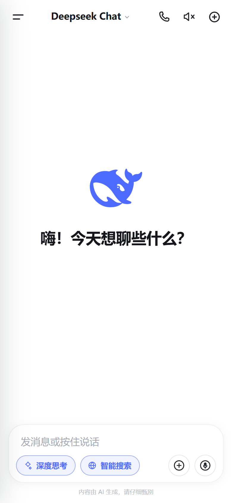 | 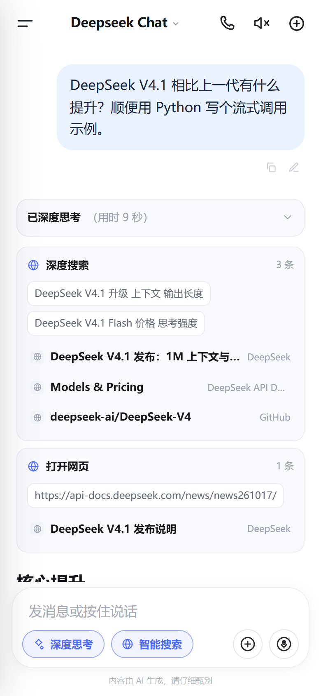 | 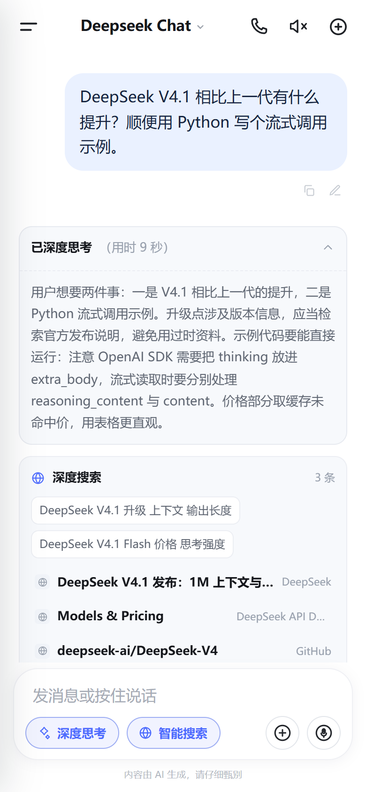 |

| Markdown / code | Mermaid diagrams | Session sidebar |
| --- | --- | --- |
| 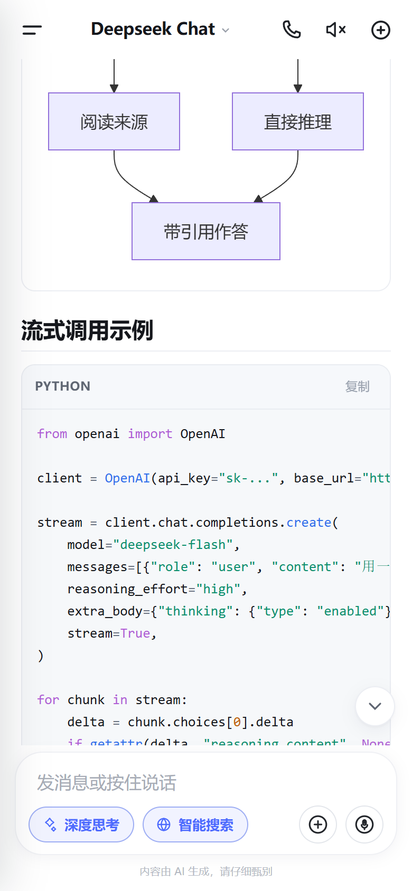 | 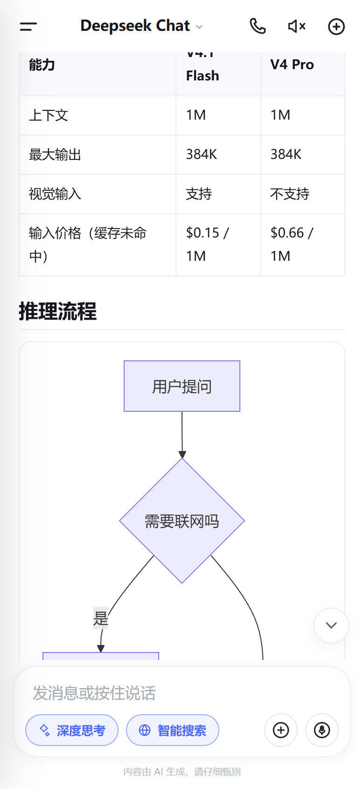 | 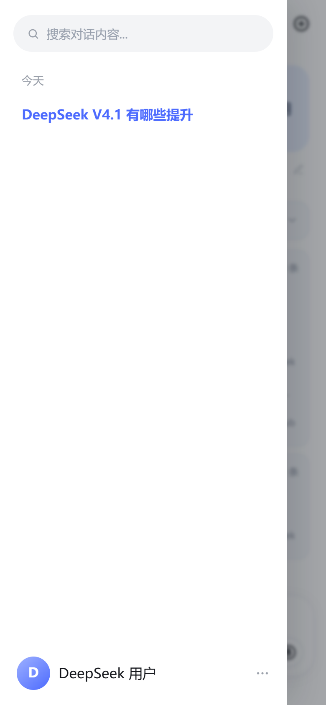 |

| Settings | System prompt | Model selection |
| --- | --- | --- |
| 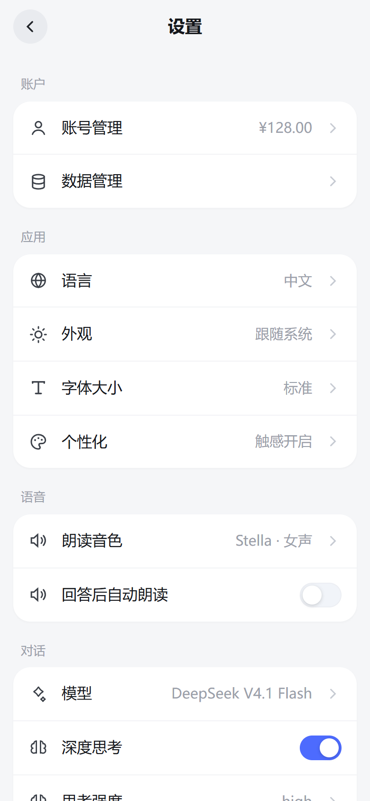 | 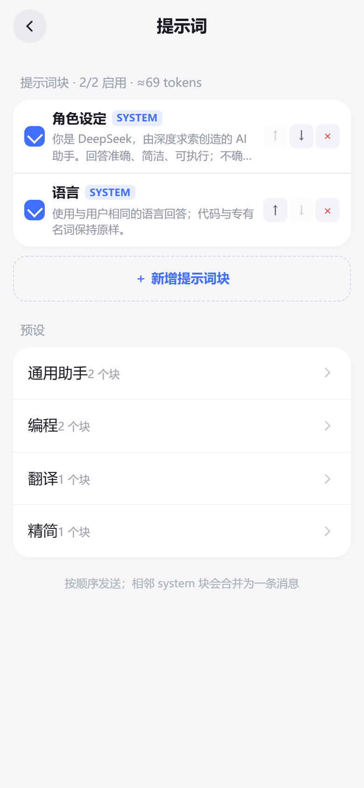 | 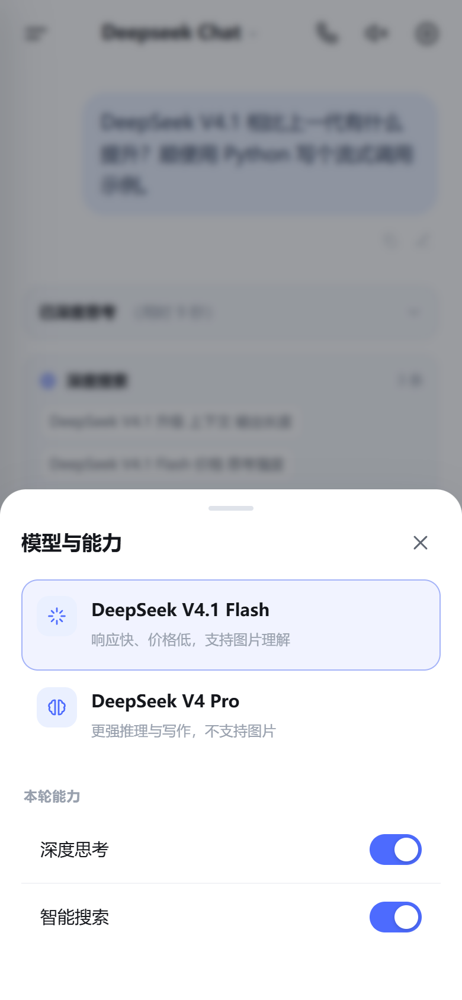 |

| Standalone search | Dark mode | Usage stats |
| --- | --- | --- |
| 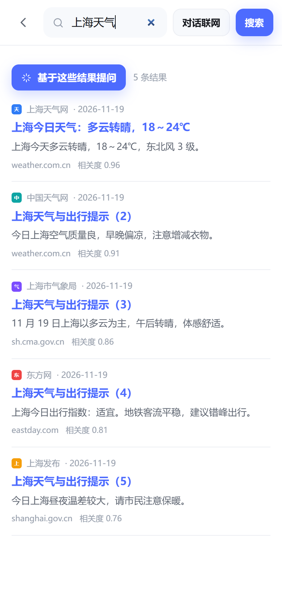 | 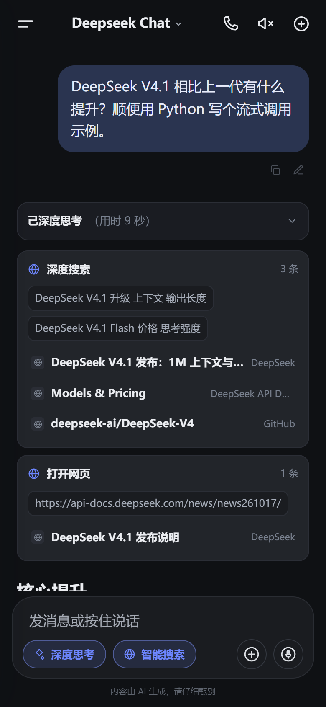 | 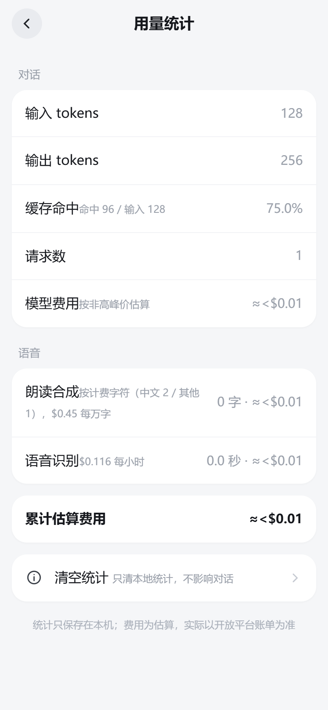 |

| Sign-in | Message branches | Android APK on a real device |
| --- | --- | --- |
| 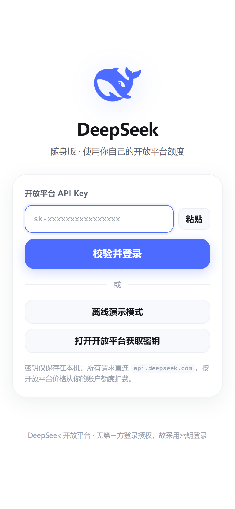 | 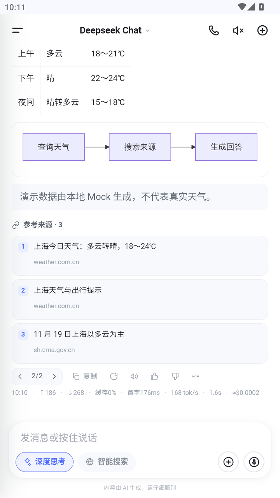 | 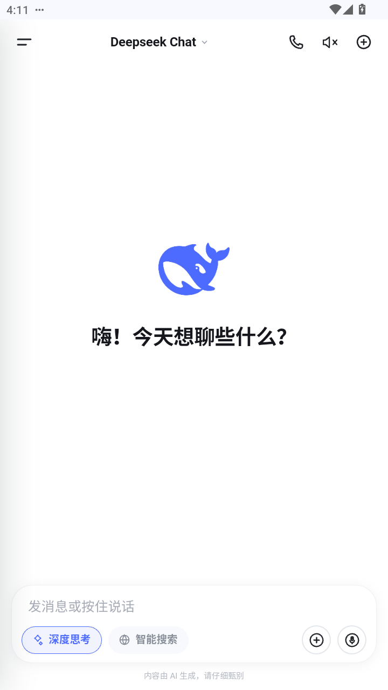 |

---

## 2. Features

### Conversation

- Streaming output with stop at any time; a collapsible deep-thinking panel with a timer; reasoning effort `low / high / max`
- **Smart search**: server-side `deepseek_web_search` / `deepseek_read_url`, with the retrieval steps visualised (queries, result cards, opened pages), `[n]` markers in the answer body plus a reference list
- Image understanding (`image_url`) and document Q&A (parsed through the Files API, then referenced by `file_id`)
- **Complete usage line**: `↑ input · ↓ output · cache hit rate · thinking tokens · first-token latency · output speed · duration · estimated cost`
- Message actions: copy, regenerate (keeping earlier versions with a `‹ n/m ›` switcher), edit and resend, read aloud, like/dislike, delete, export as Markdown
- Markdown / tables / task lists / syntax highlighting (15 languages + copy) / **Mermaid** / TeX (fractions, roots, matrices, cases, aligned, large operators)
- Multi-turn context, with `latest_reminder` (date, region, language) injected ahead of every user message
- Optional content-safety moderation (off by default; `safety_check: high`)

### Voice

- **Voice input**: WebAudio capture → 16 kHz mono WAV → `/v1/tools/asr`; **hold to talk** (release and it recognises, then sends)
- **Read-aloud**: `/v1/tools/tts`, two voices (`stella` / `tide`), speed 0.6–1.6x, long text split into sentences; play and stop both live on the speaker button of the answer toolbar, with the state shown inside the message

### Sessions and personalisation

- New / switch / rename / pin / delete / long-press menu, automatic titles, time grouping, full-text search
- Export / import JSON (compatible with this app and with DeepSeek Chat export files)
- **System prompt**: custom (no length cap; it counts toward context tokens) plus 6 templates, sent as a `system` message with every request
- **Usage stats**: cumulative tokens, cache hit rate, TTS characters, ASR duration and per-item cost (stored on the device only, can be cleared)
- Account: open-platform balance display and refresh; model switching; theme (follow system / light / dark), font size, haptics

### Experience

- **Edge-to-edge support**: status bar / gesture bar / notch / IME insets injected into CSS safe areas
- **Gestures**: swipe left to close the sidebar, pull down to close bottom sheets, swipe from the left edge to go back on the search and settings pages, swipe down to dismiss images, tiered back-button handling
- PWA: installable, offline shell, shortcuts; centred reading column on desktop
- Shortcuts: `Ctrl/Cmd+K` search, `Ctrl/Cmd+N` new chat, `Esc` stop generating

---

## 3. Quick start

Requirements: Node ≥ 20 (browser/proxy mode); building the APK additionally needs JDK 17+ and the Android SDK build-tools (see [9.3](#93-building-the-apk)).

### 3.1 Browser / PWA (desktop, or a phone on the same Wi-Fi)

```bash
git clone https://github.com/nagatoquin33/deepseek-pocket.git
cd deepseek-pocket

npm install                 # optional dependency: qrcode only
node server.mjs --mock      # 1) offline demo: no key, no network, no cost
node server.mjs             # 2) live: paste your own API key on the sign-in page
node server.mjs --https     # 3) voice input needs HTTPS (a self-signed cert is generated)
```

On startup the terminal prints the local address, the phone address and a QR code:

```text
  本机访问： http://127.0.0.1:8787
  手机访问： http://192.168.31.41:8787
  预置密钥： 未配置（手机端需粘贴 API Key）
  上游模式： Mock 离线模拟（无需联网与真实 Key）
```

> The startup banner is still Chinese only. The four lines mean: local URL · phone URL · preset key (not configured, paste the API key on the phone) · upstream mode (offline mock).

Phone and computer on the same Wi-Fi → open the "手机访问" (phone) address → sign in → start using it. In Safari use "Share → Add to Home Screen"; in Chrome use "Install app".

### 3.2 Preset key (zero-input sign-in)

```bash
DEEPSEEK_API_KEY=sk-xxxx node server.mjs
# Windows PowerShell: $env:DEEPSEEK_API_KEY="sk-xxxx"; node server.mjs
```

The key exists only in the server process environment and is never handed to the frontend; logs redact `sk-*` / `Bearer`.

### 3.3 HTTPS and voice

Browsers refuse the microphone on non-HTTPS pages (except localhost). `--https` calls the system `openssl` and writes a self-signed certificate with LAN SANs into `.tls/`; on the phone, accept "continue to this website" the first time. After switching networks, delete `.tls/` and restart to regenerate it.

### 3.4 Android APK

```bash
# CI already builds it — normally just use the APK from Releases:
adb install -r DeepSeekPocket-<version>.apk

# Or build it yourself (no Gradle / Android Studio required):
npm run build:android          # Linux / macOS / CI (android/build.sh)
npm run build:android:win      # Windows (android/build.ps1)
# Output: android/dist/DeepSeekPocket-<version>.apk
```

Inside the APK the WebView page origin is `https://appassets.local` (a secure context), assets are served from the APK by `shouldInterceptRequest`, and the page calls `api.deepseek.com` directly with an `Authorization` header (the platform supports CORS). **The phone runs standalone and connects to the open platform directly.**

---

## 4. One-tap sign-in and quota

The open platform has **no third-party OAuth**, so no third party can "authorise" its way into someone's account quota; the official demo only accepts an API key too. This project takes the shortest workable path:

| Method | Experience | Best for |
| --- | --- | --- |
| Preset key on the host | Already signed in when you open it, zero typing | Single user / family use (browser mode) |
| Paste key | "Paste" → "Verify and sign in"; verification is `GET /user/balance`, which also shows the quota | General use (main APK path) |
| Offline demo | Local mock upstream, the whole UI and its interactions work | Trying it out / development / screenshots |

The key is stored on the device only (WebView `localStorage` in the APK, same-origin storage in the browser); requests carry it in the `x-ds-key` header (proxy mode) or `Authorization` (APK direct mode), and the server never persists or logs it.

---

## 5. Billing

**Billing has nothing to do with "Chat Completions vs Responses"** — the difference is "server-side web tools" versus the "bare Search API":

| Usage | Billing | Where in this project |
| --- | --- | --- |
| Conversation tokens | Model unit price (input/output; cache hits are cheaper) | Every conversation |
| **Server-side web tools** (`deepseek_web_search` / `deepseek_read_url`, supported by all three protocols) | **Retrieval itself is not billed, only tokens** (the platform dropped the server-side retrieval fee on 2026-11-18) | "Smart search" inside a chat |
| Bare `Search API` / `Fetch API` | **$0.75 per 1,000 successful requests** | Standalone search panel (prices are shown in the UI, which also offers the free "chat with the web" entry) |
| TTS `/v1/tools/tts` | $0.45 per 10k billed characters (Chinese counts double; limited-time 50% off) | Read-aloud |
| ASR `/v1/tools/asr` | $0.116 per hour (limited-time 50% off) | Voice input |
| Document parsing / OCR | $0.225 per 1,000 pages | Document Q&A |
| Balance, models, session titles | Free | Sign-in, settings, auto titles |

Costs shown in the app are **estimates** (at off-peak prices); the open-platform bill is authoritative. The usage page accumulates model, TTS and ASR costs separately.

### Why Chat Completions instead of Responses

Both have the same capabilities and the same billing (both can use the server-side web tools). Chat Completions was chosen because streaming deltas are the simplest, multi-turn plus "edit and resend / regenerate" state stays fully controllable on the client, and the OpenAI SDK ecosystem is the widest; the main benefit of Responses is server-side conversation storage, which is redundant when sessions are managed locally. Details in [docs/API-MAPPING.md](docs/API-MAPPING.md).

---

## 6. API map

| Capability | Endpoint | Code |
| --- | --- | --- |
| Streaming chat | `POST /chat/completions` | `public/js/api.js#chat` |
| Thinking mode / effort | `thinking` + `reasoning_effort` | `public/js/chat.js#composeRequestBody` |
| Web search / read link | `tools:[deepseek_web_search, deepseek_read_url]` | as above |
| Citations / title / safety | `annotations`, `title`, `safety_check` | `chat.js#applyChunk` |
| Images / documents | `image_url`, `POST /files` → `file_id` | `api.js#uploadFile` |
| Search / fetch | `POST /v1/tools/search`, `/v1/tools/fetch` | Standalone search panel, reader |
| Read-aloud / recognition | `POST /v1/tools/tts`, `/v1/tools/asr` | `voice.js` |
| Balance / models / OCR | `GET /user/balance`, `/models`, `/v1/tools/ocr` | `api.js` |

Fields, streaming events and error codes: [docs/API-MAPPING.md](docs/API-MAPPING.md).

---

## 7. Architecture

```text
Android APK ── WebView (https://appassets.local, assets intercepted)
              └─ Authorization header ──► api.deepseek.com (platform supports CORS)

Browser / PWA ── same-origin fetch ──► server.mjs (static + SSE proxy + HTTPS + mock)
                └─ Authorization header ──► api.deepseek.com
```

- Frontend: plain ES modules, no bundler, no framework; `public/js/{app,api,chat,render,store,voice,search,settings,sidebar,usage,ui,demo,mock-client}.js`
- Server: framework-free `server.mjs` + `lib/*` (SSE passthrough, abort on disconnect, static files, security headers, rate limiting, QR code, self-signed certificates)
- APK shell: `android/app/src/.../MainActivity.java` (asset interception, microphone permission, file picker, export, insets, back gestures)
- Offline mock: `mock/*` simulates the upstream, for demos and end-to-end tests

---

## 8. Data and privacy

| What | Where it lives |
| --- | --- |
| API key | On the device (`localStorage`); in preset mode only in the server process environment |
| Sessions / attachments / usage stats | On the device (IndexedDB primarily, `localStorage` as fallback) |
| Content sent upstream | Only the conversation messages, attachments and voice/search requests themselves |

- The server stores no keys and no conversations, and redacts secrets in logs
- The page ships a CSP (`script-src 'self'`, `connect-src api.deepseek.com`); model output goes through a purpose-built renderer that escapes everything, with a link allowlist
- Details in [SECURITY.md](SECURITY.md)

---

## 9. Development, testing and CI

### 9.1 Commands

| Command | What it does |
| --- | --- |
| `npm start` / `npm run mock` / `npm run https` | Start the server |
| `npm test` | 209 tests: server, renderer, branches, doctor |
| `npm run qa` | Headless Chrome end-to-end (start `--mock --port 8899` first) |
| `npm run qa:voice` | Fake microphone recording → ASR → speaker button toggle |
| `npm run doctor` | Health check: Node / openssl / certificate SAN / ports / JDK / SDK / signing |
| `npm run shots` | Regenerate the documentation screenshots in `docs/screenshots/` |
| `node tools/qa/extract-logo.py` / `make-icons.py` | Extract the mark from the official icon and generate launcher icons |

### 9.2 Test coverage

- Server: real SSE streaming timing, 401/413/429, path traversal, CSP, every mock endpoint, TTS RIFF, ASR, QR-code allowlist, key redaction
- Renderer: XSS (script/onerror/javascript:/iframe/svg onload/attribute injection), code fences, tables, math, citation markers, 8 KB performance
- End-to-end: sign-in → demo → streaming chat → sidebar → settings → search, with zero console/page errors required

### 9.3 Building the APK

Requires JDK 17+ and the Android SDK (build-tools + `platforms/android-34+`).
`android/build.sh` does the whole build by hand: `aapt2 → javac → d8 → zip dex → zipalign → apksigner`.

### 9.4 GitHub Actions

On every push / PR:

1. `npm test`;
2. `bash android/build.sh` builds a signed APK;
3. uploads the `DeepSeekPocket-apk` artifact;
4. on a `v*` tag, creates a Release automatically (version from the tag, with a SHA256).

For a stable signing key, set these repository secrets: `KEYSTORE_BASE64` / `KEYSTORE_PASSWORD` / `KEY_ALIAS` / `KEY_PASSWORD`; without them a throwaway debug certificate is generated.

---

## 10. Compatibility

| Platform | Requirement | Notes |
| --- | --- | --- |
| Android APK | Android 8.0+ (minSdk 24), targetSdk 34 | Uses the system WebView; verified on MuMu (Android 12 / WebView 110) |
| Mobile browsers | Chrome / Edge 110+, Safari 15+ | Older WebViews lack `color-mix`; fallback styles are included |
| Desktop browsers | Latest Chrome / Edge / Firefox / Safari | Centred reading column |
| Server | Node 20+ | Windows / Linux / macOS |
| Voice input | HTTPS or localhost | Browser secure-context requirement |

---

## 11. Known limitations

1. **No OAuth one-tap sign-in** (the platform offers no third-party authorisation), hence "preset key / paste key".
2. The replica is **high-fidelity**, not pixel-perfect; no private assets from the official app are used.
3. The Responses / Anthropic Messages protocols are not wired up (capabilities are equivalent; they can be added).
4. Math covers common TeX structures (fractions, roots, matrices, cases, aligned, large operators with limits); Markdown does not pass raw HTML through (security first).
5. Missing: continue generating, ZIP import/export with attachments, a bilingual UI.
6. Read-aloud synthesises one WAV per segment (the TTS WebSocket streaming mode is not used).
7. iOS self-signed certificates must be trusted by hand; some Android browsers block the microphone on self-signed HTTPS.
8. Server rate limiting is an in-process fixed window and ignores `X-Forwarded-For`; for public deployments add your own reverse proxy and authentication.
9. Costs and usage are local estimates; the platform bill is authoritative.

---

## 12. FAQ

401 / 402 / microphone / self-signed certificates / port conflicts / silent read-aloud / signing after an upgrade … see [docs/FAQ.md](docs/FAQ.md).

---

## 13. Compliance and trademarks

- When you offer this as a service, turn on **content-safety moderation** in the settings and complete your own obligations (LLM filing, AI-generated-content labelling, etc.); every answer keeps the "AI-generated content, please verify" notice underneath.
- Please follow the [DeepSeek open-platform terms of service](https://cdn.deepseek.com/policies/zh-CN/deepseek-open-platform-terms-of-service.html).
- "DeepSeek" and the whale mark belong to DeepSeek, Inc.; this is an unofficial client for personal use, and no official assets are redistributed with it.

---

## 14. Compared with the official open-source demo

The official [chat-demo](https://github.com/deepseek-ai/chat-demo) is a static React + TypeScript site using the Messages API + Files API, connecting directly from the browser. Feature comparison:

| Capability | This project | Notes |
| --- | --- | --- |
| Multiple sessions / auto titles / rename / delete | ✅ | |
| Edit and resend / regenerate | ✅ | |
| Message-branch switching | ✅ | Regeneration keeps earlier versions; switch back and forth |
| Streaming / deep thinking / web search / read link / citations | ✅ | |
| Stop generating / continue generating | ✅ / ❌ | Continue generating is not wired up |
| Upload / paste / drag-and-drop attachments | ✅ | |
| Voice input / read-aloud / spectrum | ✅ / ✅ / RMS waveform | |
| Markdown / syntax highlighting | ✅ | Purpose-built renderer with 132 tests |
| KaTeX math | ⚠️ Purpose-built TeX renderer | Covers common structures, not full KaTeX |
| Mermaid | ✅ | Bundled locally, works offline |
| Bilingual UI | ❌ | |
| Light / dark / mobile | ✅ | Plus PWA and an Android APK |
| Location / language settings | ✅ | `latest_reminder` |
| ZIP history import/export | ⚠️ JSON | Without the original attachments |
| Protocol | Chat Completions | Official demo uses Messages |

This project adds: a standalone Android APK, a local proxy mode, a standalone Search API panel, balance and usage stats, system prompts, edge-to-edge gestures, 132 automated tests and CI packaging.

---

## 15. License

MIT (see [LICENSE](LICENSE)). Issues and PRs are welcome — see [CONTRIBUTING.md](CONTRIBUTING.md) and [SECURITY.md](SECURITY.md).
