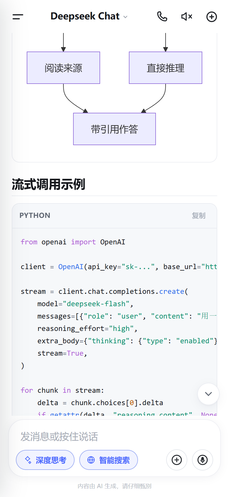
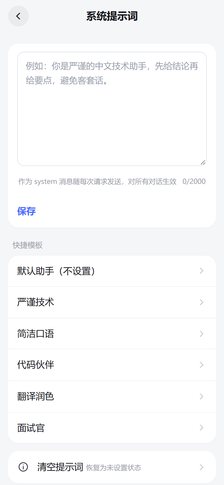
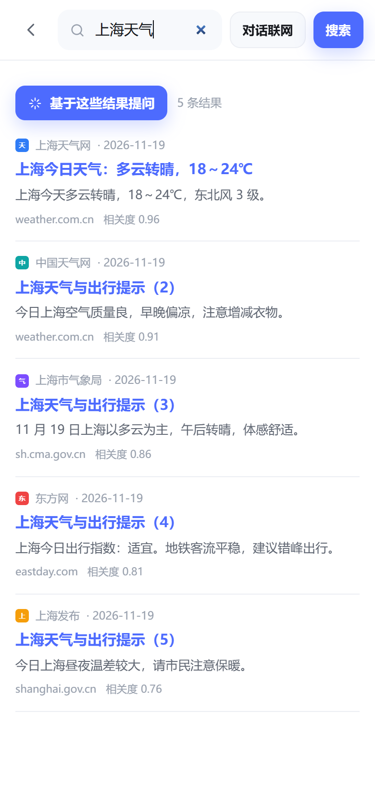

# DeepSeek 随身版（DeepSeek Pocket）

[](https://github.com/nagatoquin33/deepseek-pocket/actions/workflows/build-apk.yml)
[](https://github.com/nagatoquin33/deepseek-pocket/releases/latest)
[](LICENSE)
[](#10-兼容性)

手机上的 DeepSeek，**用你自己的开放平台（platform.deepseek.com）额度**。
深度思考、智能搜索与引用、语音输入与朗读、多会话、系统提示词、用量统计，一个不落。
零构建、零前端框架：Android 用直连 API 的原生壳，浏览器用 Node 起一个局域网服务。

> 非官方客户端，与深度求索无隶属关系。界面按官方 App 2.8 重绘，鲸鱼图标为官方彩色版，仅个人自用。

---

## 30 秒上手

| 我想要… | 怎么做 |
| --- | --- |
| **直接装 APK** | 到 [Releases](https://github.com/nagatoquin33/deepseek-pocket/releases/latest) 下载 `DeepSeekPocket-*.apk`，安装后在登录页粘贴 API Key |
| **先看看长什么样** | 官方演示站：<https://cdn.deepseek.com/chat-demo>；或看下面的[截图](#1-它长什么样) |
| **离线跑一遍（不花钱）** | `node server.mjs --mock`，手机/电脑打开终端里的地址，点「离线演示模式」 |
| **自己打包 APK** | `bash android/build.sh`（Linux/macOS/CI）或 `powershell -File android/build.ps1`（Windows） |
| **浏览器 / PWA 用** | `node server.mjs`，手机同 Wi-Fi 打开地址，Safari/Chrome「添加到主屏幕」 |

> 文档导航：[截图](#1-它长什么样) · [功能](#2-功能) · [快速开始](#3-快速开始) · [登录](#4-一键登录与额度) · [计费](#5-计费说明) · [API 映射](#6-用到了哪些-api) · [架构](#7-架构) · [隐私](#8-数据与隐私) · [开发与 CI](#9-开发测试与-ci) · [兼容性](#10-兼容性) · [限制](#11-已知限制) · [FAQ](docs/FAQ.md) · [更新日志](CHANGELOG.md) · [API 细节](docs/API-MAPPING.md) · [参与贡献](CONTRIBUTING.md) · [安全](SECURITY.md)

---

## 1. 它长什么样

按官方 App 2.8 重做：首页「嗨！今天想聊些什么？」、顶栏三段式、输入卡「发消息或按住说话」、设置分组白卡、无头像的极简消息排版。

| 首页 | 对话（思考 / 搜索 / 引用） | 深度思考展开 |
| --- | --- | --- |
|  |  |  |

| Markdown / 代码 | Mermaid 图表 | 会话侧栏 |
| --- | --- | --- |
|  |  |  |

| 设置 | 系统提示词 | 模型选择 |
| --- | --- | --- |
|  |  |  |

| 独立搜索 | 深色模式 | 用量统计 |
| --- | --- | --- |
|  |  |  |

| 登录 | Android APK 实机 |
| --- | --- |
|  |  |

---

## 2. 功能

### 对话
- 流式输出，随时停止；深度思考折叠面板 + 计时；思考强度 `low / high / max`
- **智能搜索**：服务端 `deepseek_web_search` / `deepseek_read_url`，检索步骤可视化（查询词、结果卡片、打开网页），正文 `[n]` 角标 + 参考来源
- 图片理解（`image_url`）与文档问答（Files API 解析后 `file_id` 引用）
- **完整用量**：`↑输入 · ↓输出 · 缓存命中率 · 思考 token · 首字延迟 · 输出速度 · 耗时 · 估算费用`
- 消息操作：复制、重新生成、编辑重发、朗读、点赞/点踩、删除、导出 Markdown
- Markdown / 表格 / 任务列表 / 代码高亮（15 语言 + 复制）/ **Mermaid** / TeX 公式子集
- 多轮上下文 + 每条用户消息前注入 `latest_reminder`（日期、地区、语言）
- 内容安全审核可选（默认关闭，`safety_check: high`）

### 语音
- **语音输入**：WebAudio 采集 → 16kHz 单声道 WAV → `/v1/tools/asr`；支持**按住说话**（松手自动识别并发送）
- **朗读**：`/v1/tools/tts`，`stella` / `tide` 双音色、语速 0.6–1.6x、长文分句；播放/停止就在回答的喇叭按钮上切换，**无浮动播放条**

### 会话与个性化
- 新建 / 切换 / 重命名 / 置顶 / 删除 / 长按菜单，自动标题，时间分组，全文搜索
- 导出 / 导入 JSON（兼容本应用与 DeepSeek Chat 导出结构）
- **系统提示词**：≤2000 字自定义 + 6 套模板，作为 `system` 消息随请求发送
- **用量统计**：累计 token、缓存命中率、TTS 字符、ASR 时长与分项费用（只存本机，可清空）
- 账号：开放平台余额展示与刷新；模型切换；主题（跟随系统/浅色/深色）、字号、触感

### 体验
- **全面屏适配**：状态栏 / 导航手势条 / 刘海 / 输入法 insets 注入 CSS 安全区
- **手势**：侧栏左滑关闭、底部抽屉下拉关闭、搜索/设置页左缘右滑返回、图片下滑关闭、返回键分级处理
- PWA：可安装、离线外壳、快捷方式；桌面端居中阅读列
- 快捷键：`Ctrl/Cmd+K` 搜索、`Ctrl/Cmd+N` 新对话、`Esc` 停止生成

---

## 3. 快速开始

要求：Node ≥ 20（浏览器/代理模式）；APK 构建另需 JDK 17+ 与 Android SDK build-tools（详见 [9.3](#93-构建-apk)）。

### 3.1 浏览器 / PWA（电脑或同 Wi-Fi 手机）

```bash
git clone https://github.com/nagatoquin33/deepseek-pocket.git
cd deepseek-pocket

npm install                 # 仅 qrcode 可选依赖
node server.mjs --mock      # 1) 离线演示：不需要 Key、不联网、不花钱
node server.mjs             # 2) 正式：手机登录页粘贴自己的 API Key
node server.mjs --https     # 3) 语音输入需要 HTTPS（自动生成自签证书）
```

启动后终端会打印本地地址、手机地址与二维码：

```
本地访问   http://127.0.0.1:8787
手机访问   http://192.168.31.41:8787
密钥       未预置（请在手机端粘贴）
上游       离线 Mock / api.deepseek.com
```

手机与电脑同 Wi-Fi → 打开「手机访问」地址 → 登录 → 开始用。Safari「分享 → 添加到主屏幕」、Chrome「安装应用」即可当 App。

### 3.2 预置密钥（免输入一键登录）

```bash
DEEPSEEK_API_KEY=sk-xxxx node server.mjs
# Windows PowerShell: $env:DEEPSEEK_API_KEY="sk-xxxx"; node server.mjs
```

密钥只存在于服务进程环境变量，不下发到前端；日志对 `sk-*` / `Bearer` 脱敏。

### 3.3 HTTPS 与语音

浏览器规定非 HTTPS 页面（除 localhost）不能用麦克风。`--https` 会自动调用系统 `openssl` 生成带局域网 SAN 的自签证书到 `.tls/`；手机上首次访问选择「继续访问」即可。换网络后删除 `.tls/` 重启重新生成。

### 3.4 Android APK

```bash
# CI 已自动打包，一般直接用 Release 里的 APK：
adb install -r DeepSeekPocket-1.0.1.apk

# 自己构建（不需要 Gradle / Android Studio）：
npm run build:android          # Linux / macOS / CI（android/build.sh）
npm run build:android:win      # Windows（android/build.ps1）
# 产物：android/dist/DeepSeekPocket-<version>.apk
```

APK 内 WebView 的页面源是 `https://appassets.local`（安全上下文），资源由 `shouldInterceptRequest` 从 APK assets 提供，页面直接带 `Authorization` 调 `api.deepseek.com`（平台已支持 CORS）。**因此手机端不需要电脑、不需要代理。**

---

## 4. 一键登录与额度

开放平台**没有第三方 OAuth 授权**，第三方无法「授权登录」使用某个账号额度，官方 Demo 同样只支持输入 API Key。本项目把一键做到可行范围内的最短路径：

| 方式 | 体验 | 适用 |
| --- | --- | --- |
| 本机预置密钥 | 打开即登录，零输入 | 单人 / 家庭自用（浏览器模式） |
| 粘贴密钥 | 「粘贴」→「校验并登录」，校验即 `GET /user/balance`，顺带显示额度 | 通用（APK 主路径） |
| 离线演示 | 本地 Mock 上游，完整跑通界面与交互 | 体验 / 开发 / 截图 |

密钥只保存在设备本地（APK 为 WebView localStorage，浏览器同源存储），请求时放在 `x-ds-key`（代理模式）或 `Authorization`（APK 直连）头里，服务端不落盘、不写日志。

---

## 5. 计费说明

**计费与「Chat Completions / Responses」协议无关**，区别在「服务端 web 工具」与「裸 Search API」：

| 用法 | 计费 | 本项目位置 |
| --- | --- | --- |
| 对话 token | 按模型单价（输入/输出、缓存命中价更低） | 所有对话 |
| **服务端 web 工具**（`deepseek_web_search` / `deepseek_read_url`，三种协议都支持） | **检索不单独计费，只计 token**（2026-11-18 起官方取消服务端检索费） | 对话内「智能搜索」 |
| 裸 `Search API` / `Fetch API` | **$0.75 / 千次成功请求** | 独立搜索面板（界面已标价，并提供「对话联网」免费入口） |
| TTS `/v1/tools/tts` | $0.45 / 万计费字符（中文按 2 计；限时 5 折） | 朗读 |
| ASR `/v1/tools/asr` | $0.116 / 小时（限时 5 折） | 语音输入 |
| 文档解析 / OCR | $0.225 / 千页 | 文档问答 |
| 余额、模型列表、会话标题 | 免费 | 登录、设置、自动标题 |

应用内的费用均为**估算**（按非高峰价）；实际以开放平台账单为准。用量统计页会分别累计模型、TTS、ASR 三部分。

### 为什么用 Chat Completions 而不是 Responses
两者能力与计费一致（都能用服务端 web 工具）。选 Chat Completions 的原因：流式增量最简单、多轮与「编辑重发/重新生成」的客户端状态最可控、OpenAI SDK 生态最广；Responses 的收益主要是服务端会话存储，对「本地会话管理」反而多余。详见 [docs/API-MAPPING.md](docs/API-MAPPING.md)。

---

## 6. 用到了哪些 API

| 能力 | 端点 | 代码 |
| --- | --- | --- |
| 流式对话 | `POST /chat/completions` | `public/js/api.js#chat` |
| 思考模式 / 强度 | `thinking` + `reasoning_effort` | `public/js/chat.js#composeRequestBody` |
| 联网 / 读链接 | `tools:[deepseek_web_search, deepseek_read_url]` | 同上 |
| 引用 / 标题 / 安全 | `annotations`、`title`、`safety_check` | `chat.js#applyChunk` |
| 图片 / 文档 | `image_url`、`POST /files` → `file_id` | `api.js#uploadFile` |
| 搜索 / 抓取 | `POST /v1/tools/search`、`/v1/tools/fetch` | 独立搜索面板、阅读器 |
| 朗读 / 识别 | `POST /v1/tools/tts`、`/v1/tools/asr` | `voice.js` |
| 余额 / 模型 / OCR | `GET /user/balance`、`/models`、`/v1/tools/ocr` | `api.js` |

字段、流式事件与错误码见 [docs/API-MAPPING.md](docs/API-MAPPING.md)。

---

## 7. 架构

```
Android APK ── WebView(https://appassets.local, assets 拦截) ──┐
                                                              ├── HTTPS + CORS ──► api.deepseek.com
浏览器/PWA ── 同源 fetch ──► server.mjs（静态 + SSE 代理 + HTTPS + Mock）──┘
```

- 前端：原生 ES Module，无打包、无框架；`public/js/{app,api,chat,render,store,voice,search,settings,sidebar,usage,ui,demo,mock-client}.js`
- 服务端：零框架 `server.mjs` + `lib/*`（SSE 透传、断连中止、静态、安全头、限流、二维码、自签证书）
- APK 壳：`android/app/src/.../MainActivity.java`（资产拦截、麦克风授权、文件选择、导出、insets、手势返回）
- 离线 Mock：`mock/*` 完整模拟上游，供演示与端到端测试

---

## 8. 数据与隐私

| 内容 | 存储位置 |
| --- | --- |
| API Key | 设备本地（localStorage）；预置模式只在服务进程环境变量 |
| 会话 / 附件 / 用量统计 | 设备本地（IndexedDB 为主，localStorage 兜底） |
| 发送给上游的内容 | 仅对话消息、附件、语音/检索请求本身 |

- 服务端不保存密钥与对话，日志对密钥脱敏
- 页面启用 CSP（`script-src 'self'`、`connect-src api.deepseek.com`），模型输出经自研渲染器全量转义，链接白名单
- 详见 [SECURITY.md](SECURITY.md)

---

## 9. 开发、测试与 CI

### 9.1 命令

| 命令 | 说明 |
| --- | --- |
| `npm start` / `npm run mock` / `npm run https` | 启动服务 |
| `npm test` | 132 项：服务端 26 + 渲染器 106 |
| `npm run qa` | Chrome 无头端到端（需先起 `--mock --port 8899`） |
| `npm run qa:voice` | 假麦克风录音 → ASR → 朗读按钮切换 |
| `npm run shots` | 生成 `docs/screenshots/` 文档截图 |
| `node tools/qa/extract-logo.py` / `make-icons.py` | 从官方图标提取标记并生成启动图标 |

### 9.2 测试覆盖

- 服务端：SSE 真流式时序、401/413/429、路径穿越、CSP、Mock 全端点、TTS RIFF、ASR、二维码白名单、密钥脱敏
- 渲染器：XSS（script/onerror/javascript:/iframe/svg onload/属性注入）、代码围栏、表格、数学、引用角标、8KB 性能
- 端到端：登录 → 演示 → 流式对话 → 侧栏 → 设置 → 搜索，要求 0 console/pageerror

### 9.3 构建 APK

需要 JDK 17+、Android SDK（build-tools + `platforms/android-34+`）。
`android/build.sh` 手工完成 `aapt2 → javac → d8 → zip dex → zipalign → apksigner`，不依赖 Gradle。

### 9.4 GitHub Actions

每次 push / PR：

1. `npm test`；
2. `bash android/build.sh` 构建已签名 APK；
3. 上传 artifact `DeepSeekPocket-apk`；
4. 推送 `v*` 标签时自动创建 Release（版本号跟随 tag，附 SHA256）。

固定签名请在仓库 Secrets 配置：`KEYSTORE_BASE64` / `KEYSTORE_PASSWORD` / `KEY_ALIAS` / `KEY_PASSWORD`；未配置时生成一次性调试证书。

---

## 10. 兼容性

| 平台 | 要求 | 说明 |
| --- | --- | --- |
| Android APK | Android 8.0+（minSdk 24），targetSdk 34 | 依赖系统 WebView；MuMu（Android 12 / WebView 110）实测通过 |
| 移动浏览器 | Chrome / Edge 110+、Safari 15+ | 旧 WebView 无 `color-mix`，已提供回退样式 |
| 桌面浏览器 | Chrome / Edge / Firefox / Safari 最新版 | 居中阅读列布局 |
| 服务端 | Node 20+ | Windows / Linux / macOS |
| 语音输入 | HTTPS 或 localhost | 浏览器安全上下文限制 |

---

## 11. 已知限制

1. **没有 OAuth 一键登录**（平台未提供第三方授权），故为「预置密钥 / 粘贴密钥」。
2. 复刻是**高保真**而非像素级；未使用官方 App 私有资源。
3. 未接入 Responses / Anthropic Messages 协议（能力等价，可扩展）。
4. 数学公式为 TeX 子集（无 matrix/cases）；Markdown 不透传原始 HTML（安全优先）。
5. 缺少：消息分支切换、继续生成、ZIP 带附件导入导出、中英双语界面。
6. 朗读为整段 WAV 合成（未用 TTS WebSocket 边生成边播）。
7. iOS 自签证书需手动信任；部分 Android 浏览器会拦截自签 HTTPS 的麦克风。
8. 服务端限流为进程内固定窗口，未解析 `X-Forwarded-For`；公网部署请自行加反向代理与鉴权。
9. 费用与用量为本地估算，实际以平台账单为准。

---

## 12. 常见问题

401 / 402 / 麦克风 / 自签证书 / 端口占用 / 语音无声 / 升级签名 … 见 [docs/FAQ.md](docs/FAQ.md)。

---

## 13. 合规与商标

- 对外提供服务时，请开启设置中的**内容安全审核**，并自行完成大模型备案、AI 生成内容标识等义务；每条回答下方保留「内容由 AI 生成，请仔细甄别」。
- 请遵守 [DeepSeek 开放平台服务条款](https://cdn.deepseek.com/policies/zh-CN/deepseek-open-platform-terms-of-service.html)。
- 「DeepSeek」与鲸鱼标记归 DeepSeek, Inc. 所有；本项目为个人自用的非官方客户端，不随包对外分发官方素材。

---

## 14. 与官方开源 Demo 的对照

官方 [chat-demo](https://github.com/deepseek-ai/chat-demo) 是 React + TypeScript 静态站，用 Messages API + Files API，浏览器直连。功能对照：

| 能力 | 本项目 | 说明 |
| --- | --- | --- |
| 多会话 / 自动标题 / 重命名 / 删除 | ✅ | |
| 编辑重发 / 重新生成 | ✅ | |
| 消息分支切换 | ❌ | 覆盖式重新生成 |
| 流式 / 深度思考 / 联网 / 读链接 / 引用 | ✅ | |
| 停止生成 / 继续生成 | ✅ / ❌ | 继续生成未接入 |
| 上传 / 粘贴 / 拖拽附件 | ✅ | |
| 语音输入 / 朗读 / 频谱 | ✅ / ✅ / RMS 波形 | |
| Markdown / 代码高亮 | ✅ | 自研渲染器 106 项测试 |
| KaTeX 数学 | ⚠️ TeX 子集 | |
| Mermaid | ✅ | 本地内置，离线可用 |
| 中英双语界面 | ❌ | |
| 浅色 / 深色 / 移动端 | ✅ | 另有 PWA、Android APK |
| 位置 / 语言设置 | ✅ | `latest_reminder` |
| ZIP 历史导入导出 | ⚠️ JSON | 不含原始附件 |
| 协议 | Chat Completions | 官方 Messages |

本项目额外提供：Android APK 直连、本机代理模式、独立 Search API 面板、余额与用量统计、系统提示词、全面屏手势、132 项自动化测试与 CI 打包。

---

## 15. 许可

MIT（见 [LICENSE](LICENSE)）。欢迎 issue / PR，参见 [CONTRIBUTING.md](CONTRIBUTING.md) 与 [SECURITY.md](SECURITY.md)。
