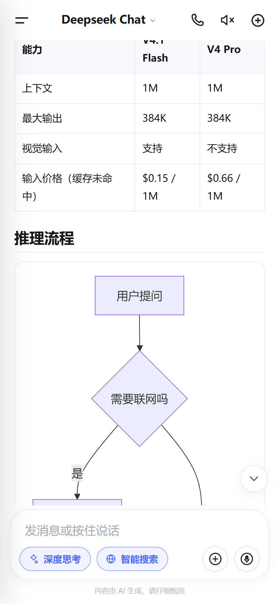
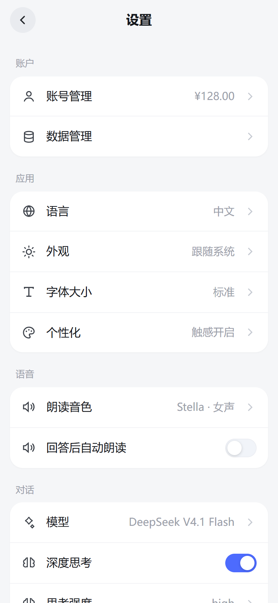
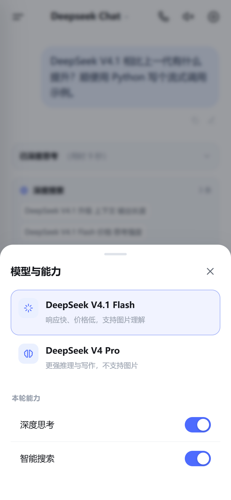

# DeepSeek 闅忚韩鐗堬紙DeepSeek Pocket锛?
鎵嬫満涓婄殑 DeepSeek锛?*鐢ㄤ綘鑷繁鐨勬繁搴︽眰绱㈠紑鏀惧钩鍙帮紙platform.deepseek.com锛夐搴?*锛屾繁搴︽€濊€冦€佽仈缃戞悳绱€佽闊宠緭鍏?鏈楄銆佸浼氳瘽绠＄悊锛屼竴涓笉钀姐€?
鎻愪緵涓ょ褰㈡€侊細**Android APK**锛堢洿杩炲紑鏀惧钩鍙般€佹棤闇€鐢佃剳锛変笌 **娴忚鍣?/ PWA**锛堥厤鏈満浠ｇ悊锛岄€傚悎妗岄潰涓庡眬鍩熺綉澶氳澶囷級銆?闆舵瀯寤恒€侀浂鍓嶇妗嗘灦锛孨ode 璧蜂竴涓眬鍩熺綉鏈嶅姟灏辫兘鍦ㄦ墜鏈烘祻瑙堝櫒閲岀敤锛屼篃鍙互銆屾坊鍔犲埌涓诲睆骞曘€嶅綋 App銆?
> 璇存槑锛氳繖鏄?*鍩轰簬 DeepSeek 寮€鏀惧钩鍙?API 鐨勯珮淇濈湡澶嶅埢瀹炵幇**锛屼笉鏄畼鏂?App銆傜晫闈㈡寜瀹樻柟 2.8 鎴浘閲嶇粯锛涢哺楸兼爣璁颁负瀹樻柟褰╄壊鐗堬紙鐢ㄦ埛鎻愪緵锛夛紝鍚姩鍥炬爣鐢卞叾鍚堟垚锛屼粎浣滀釜浜鸿嚜鐢紝涓嶉殢鍖呭澶栧垎鍙戙€?> 銆屼竴姣斾竴銆嶆寚鐣岄潰缁撴瀯銆佷氦浜掍笌淇℃伅灞傜骇瀵归綈瀹樻柟 App锛涘儚绱犵骇缁嗚妭浠ユ湰浠撳簱鎴浘涓哄噯銆?
---

## 1. 它长什么样

按官方 App 2.8 重做（首页问候语、顶栏、输入卡、侧栏、设置分组、消息排版）。
图标为官方彩色鲸鱼标记；启动图标与 favicon 由其合成。

| 首页 | 对话（思考 / 搜索 / 引用） | 深度思考展开 |
| --- | --- | --- |
|  |  |  |

| Markdown / 代码 | Mermaid 图表 | 会话侧栏 |
| --- | --- | --- |
|  |  |  |

| 设置 | 系统提示词 | 模型选择 |
| --- | --- | --- |
|  |  |  |

| 独立搜索 | 深色模式 | 登录 |
| --- | --- | --- |
|  |  |  |

| Android APK 实机 |
| --- |
|  |

> 效果图由无头 Chrome（390×844）与 MuMu 模拟器（Android 12 / WebView 110）实机截取。

## 2. 鍔熻兘

### 瀵硅瘽
- 娴佸紡杈撳嚭锛圫SE 閫忎紶锛岄€愬瓧涓婂睆锛屽彲闅忔椂鍋滄锛?- **娣卞害鎬濊€?*锛氭姌鍙犻潰鏉裤€佸疄鏃惰鏃躲€併€屽凡娣卞害鎬濊€冿紙鐢ㄦ椂 N 绉掞級銆嶏紱鎬濊€冨己搴?`蹇€?/ 鏍囧噯 / 鏇村己`锛坄low / high / max`锛?- **鑱旂綉鎼滅储**锛氭湇鍔＄ `deepseek_web_search` / `deepseek_read_url` 宸ュ叿锛涙绱㈡楠ゅ彲瑙嗗寲锛堟煡璇㈣瘝銆佺粨鏋滃崱鐗囥€佹墦寮€缃戦〉銆侀〉鍐呮煡鎵撅級锛屾鏂囧甫 `[1]` 瑙掓爣涓庛€屽弬鑰冩潵婧愩€嶅垪琛?- **澶氳疆涓婁笅鏂?*锛氬畬鏁村洖浼犲巻鍙?+ 姣忔潯鐢ㄦ埛娑堟伅鍓嶆敞鍏?`latest_reminder`锛堟棩鏈?鏄熸湡/鍦板尯/骞冲彴/璇█锛?- **娑堟伅鎿嶄綔**锛氬鍒躲€侀噸鏂扮敓鎴愩€佺紪杈戝悗閲嶅彂銆佹湕璇汇€佺偣璧?鐐硅俯銆佸垹闄ゃ€佸鍑?Markdown
- **Markdown 娓叉煋**锛氭爣棰樸€佽〃鏍笺€佷换鍔″垪琛ㄣ€佸紩鐢ㄣ€佷唬鐮佸潡锛?5 绉嶈瑷€楂樹寒 + 澶嶅埗鎸夐挳锛夈€佽鍐呬唬鐮併€侀摼鎺ャ€佸浘鐗囥€?*鏁板鍏紡**锛圱eX 瀛愰泦锛?- **瑙嗚杈撳叆**锛氱浉鍐?鐩告満鍥剧墖鍘嬬缉鍚庝互 `image_url` 鍙戦€侊紙`deepseek-flash`锛?- **鏂囨。闂瓟**锛歅DF / Word / PPT / Excel / 绾枃鏈笂浼?鈫?Files API 瑙ｆ瀽 鈫?`file_id` 寮曠敤
- 楗卞拰搴?绫诲瀷鍏ㄥ吋瀹圭殑 chunk 褰掍竴鍖栵細`reasoning_content`銆乣content`銆乣annotations`銆乣server_tool_calls`锛坄search / open_page / find_in_page / read_link / image_search`锛?
### 璇煶
- **璇煶杈撳叆**锛歐ebAudio 閲囬泦 鈫?16kHz 鍗曞０閬?WAV 鈫?`POST /v1/tools/asr` 鈫?鏂囨湰鍥炲～杈撳叆妗嗭紙璺?iOS/Android 涓€鑷达紝涓嶄緷璧?MediaRecorder 鐨?mp4 缂栫爜锛?- **鏈楄**锛歚POST /v1/tools/tts`锛岄煶鑹?`stella锛堝コ锛? tide锛堢敺锛塦銆佽閫?0.6鈥?.6x銆侀暱鏂囪嚜鍔ㄥ垎鍙ワ紱鎾斁/鍋滄灏卞湪鍥炵瓟鎿嶄綔鏍忕殑鍠囧彮鎸夐挳涓婂氨鍦板垏鎹紙鍚屼竴鏉″啀鐐瑰嵆鍋滐級锛?*涓嶅脊鍑烘诞鍔ㄦ挱鏀炬潯**锛涘悎鎴愰樁娈典笉鏄剧ず浠讳綍杩涘害娴眰

### 浼氳瘽绠＄悊
- 鏂板缓 / 鍒囨崲 / 閲嶅懡鍚?/ 缃《 / 鍒犻櫎 / 闀挎寜鑿滃崟
- 鑷姩鐢熸垚鏍囬锛坄title:{enabled:true}`锛岄殢鏈€鍚庝竴涓?chunk 杩斿洖锛屼笉棰濆璁¤垂锛?- 鎸?浠婂ぉ / 鏄ㄥぉ / 7 澶╁唴 / 30 澶╁唴 / 鏇存棭 鍒嗙粍
- 鍘嗗彶鎼滅储锛堟爣棰?+ 鍏ㄦ枃锛?- 瀵煎嚭鍏ㄩ儴 / 鍗曚釜瀵硅瘽涓?JSON锛屽鍏ワ紙鍏煎鏈簲鐢ㄤ笌 DeepSeek Chat 瀵煎嚭缁撴瀯锛?- 鏈湴鎸佷箙鍖栵細IndexedDB锛堥檷绾?localStorage锛夛紝**涓嶄笂浼犱换浣曟湇鍔＄**
- **绯荤粺鎻愮ず璇?*锛氳缃?鈫?瀵硅瘽 鈫?绯荤粺鎻愮ず璇嶏紝鏀寔鑷畾涔夛紙鈮?000 瀛楋級涓?6 濂楀揩鎹锋ā鏉匡紙涓ヨ皑鎶€鏈?/ 绠€娲佸彛璇?/ 浠ｇ爜浼欎即 / 缈昏瘧娑﹁壊 / 闈㈣瘯瀹橈級锛屼綔涓?`system` 娑堟伅闅忔瘡娆¤姹傚彂閫侊紱鍙瓨鏈満

### 璐﹀彿涓庨搴?- 鐧诲綍椤垫樉绀哄紑鏀惧钩鍙伴搴︼紙`GET /user/balance`锛夛紝渚ф爮甯搁┗棰濆害鍗＄墖锛屽彲鎵嬪姩鍒锋柊
- 姣忔潯鍥炵瓟鏄剧ず token 鐢ㄩ噺涓庝及绠楄垂鐢紙鎸?deepseek-flash 闈為珮宄颁环锛屼粎渚涘弬鑰冿級
- 涓夌鐧诲綍鏂瑰紡锛?*涓€閿櫥褰?*锛堟湰鏈洪缃瘑閽ワ級銆佺矘璐村瘑閽ャ€佺绾挎紨绀烘ā寮?
### 浣撻獙
- 绉诲姩浼樺厛锛氬畨鍏ㄥ尯銆乣visualViewport` 閿洏璺熼殢銆佷笅鎷変笉鍒锋柊銆乣[鍐呭鐢?AI 鐢熸垚锛岃浠旂粏鐢勫埆]`
- 娣辫壊/娴呰壊/璺熼殢绯荤粺銆佷笁妗ｅ瓧鍙枫€佽Е鎰熷弽棣?- PWA锛氬彲瀹夎銆佺绾垮澹炽€佸揩鎹锋柟寮忥紙鏂板缓瀵硅瘽 / 鎼滅储锛?- 妗岄潰绔嚜鍔ㄥ垏鎹负灞呬腑闃呰鍒?+ 鏇村渚ф爮锛沗Ctrl/Cmd+K` 鎼滅储銆乣Ctrl/Cmd+N` 鏂板璇濄€乣Esc` 鍋滄

---

## 3. 蹇€熷紑濮?
瑕佹眰锛歂ode 鈮?20锛堟湰鏈?Node 22 宸查獙璇侊級銆?*鏃犲墠绔瀯寤烘楠?*銆?
```bash
cd deepseek-mobile

# 1) 鍏堜綋楠岋紙绂荤嚎 Mock 涓婃父锛屼笉闇€瑕佸瘑閽ャ€佷笉鑱旂綉銆佷笉浜х敓璐圭敤锛?node server.mjs --mock

# 2) 姝ｅ紡浣跨敤锛堝湪鎵嬫満鐧诲綍椤电矘璐翠綘鑷繁鐨?API Key锛涙垨鍚姩鍓嶈缃幆澧冨彉閲忓疄鐜颁竴閿櫥褰曪級
DEEPSEEK_API_KEY=sk-xxxx node server.mjs        # Windows PowerShell: $env:DEEPSEEK_API_KEY="sk-xxxx"; node server.mjs

# 3) 闇€瑕佽闊宠緭鍏ワ紙娴忚鍣ㄥ彧鍏佽 HTTPS 椤甸潰鐢ㄩ害鍏嬮锛?node server.mjs --https
```

鍚姩鍚庣粓绔細鎵撳嵃锛?
```
鏈湴璁块棶   http://127.0.0.1:8787
鎵嬫満璁块棶   http://192.168.31.41:8787     鈫?鍚屼竴 Wi-Fi 涓嬬敤鎵嬫満鎵撳紑
瀵嗛挜       鏈缃紙璇峰湪鎵嬫満绔矘璐达級
涓婃父       绂荤嚎 Mock
```

鎵嬫満涓庣數鑴戣繛鍚屼竴 Wi-Fi锛岀敤銆屾墜鏈鸿闂€嶅湴鍧€鎵撳紑 鈫?鐧诲綍 鈫?寮€濮嬬敤銆?
### Android APK锛堟帹鑽愮粰鎵嬫満锛?
```bash
# 鏋勫缓锛堥渶瑕?JDK 17+ 涓?Android build-tools锛涙湰鏈虹敤 build-tools 36 + android-34锛?powershell -ExecutionPolicy Bypass -File android\build.ps1
# 浜х墿锛歛ndroid/dist/DeepSeekPocket-1.0.0.apk锛堢害 1 MB锛岃嚜绛惧悕锛屽彲鐩存帴瀹夎锛?
# 瀹夎鍒版墜鏈?/ 妯℃嫙鍣?adb install -r android/dist/DeepSeekPocket-1.0.0.apk
```

- **鏃犻渶鐢佃剳銆佹棤闇€浠ｇ悊**锛欰PK 鍐?WebView 鐨勯〉闈㈡簮鏄?`https://appassets.local`锛堝畨鍏ㄤ笂涓嬫枃锛夛紝
  鐩存帴甯?`Authorization` 璁块棶 `https://api.deepseek.com`锛堝紑鏀惧钩鍙板凡鏀寔 CORS锛屽疄娴?401 閿欒浣撳彲鍘熸牱杩斿洖锛夈€?- 闈欐€佽祫婧愰€氳繃 `shouldInterceptRequest` 浠?APK assets 鎻愪緵锛屾墍浠ョ绾垮澹炽€佸浘鏍囥€丮ermaid 涔熼兘鍦ㄥ寘鍐呫€?- 璇煶锛歚RECORD_AUDIO` 杩愯鏃舵潈闄?+ `WebChromeClient.onPermissionRequest` 鎺堟潈锛?  椤甸潰鍦ㄥ畨鍏ㄤ笂涓嬫枃閲岀敤 WebAudio 閲囬泦锛岃法 iOS/Android 涓€鑷淬€?- 鏂囦欢閫夋嫨锛歚onShowFileChooser` 鎺ョ郴缁熼€夋嫨鍣紱瀵煎嚭 JSON/Markdown 璧?`DSAndroid.saveText` 鍐欏叆銆屼笅杞?DeepSeek銆嶃€?- 杩斿洖閿細浼樺厛鍏抽棴娴眰 鈫?鍋滄鐢熸垚 鈫?閫€鍑猴紱娣辫壊涓婚鍚屾閫氱煡鍘熺敓鐘舵€佹爮銆?- 鍏煎鎬э細MuMu 妯℃嫙鍣?Android 12 / WebView 110 瀹炴祴閫氳繃锛堝惈 CSS `color-mix` 鍥為€€锛夈€?
> 棣栨瀹夎闇€鍏佽銆屽畨瑁呮湭鐭ユ潵婧愬簲鐢ㄣ€嶏紱杩欐槸涓汉鑷敤绛惧悕锛屼笉鏄簲鐢ㄥ晢搴楀垎鍙戠増鏈€?
### 鎵嬫満瀹夎涓?App
Safari锛氬垎浜?鈫?娣诲姞鍒颁富灞忓箷锛汣hrome锛氳彍鍗?鈫?娣诲姞鍒颁富灞忓箷 / 瀹夎搴旂敤銆?瀹夎鍚庡叏灞忚繍琛岋紝甯﹀浘鏍囦笌绂荤嚎澶栧３銆?
### HTTPS 涓庤闊?娴忚鍣ㄨ瀹氾細**闈?HTTPS 椤甸潰锛堥櫎 localhost锛夌姝娇鐢ㄩ害鍏嬮**銆傛墍浠ユ墜鏈虹敤璇煶闇€瑕侊細

1. `node server.mjs --https`锛堥娆′細璋冪敤绯荤粺 `openssl` 鑷姩鐢熸垚 `.tls/cert.pem` + `key.pem`锛孲AN 宸插寘鍚湰鏈哄叏閮ㄥ眬鍩熺綉 IPv4锛夛紱
2. 鎵嬫満鎵撳紑 `https://<灞€鍩熺綉IP>:8787`锛屽嚭鐜般€岃瘉涔︿笉鍙椾俊浠汇€嶆椂閫夋嫨缁х画璁块棶锛?3. 鑻ユ崲 Wi-Fi/IP锛屽垹闄?`.tls/` 鍚庨噸鍚嵆鍙噸鏂扮敓鎴愩€?
娌℃湁 `openssl` 鏃朵細涓枃鎻愮ず骞惰嚜鍔ㄥ洖閫€鍒?HTTP锛堝璇濄€佹悳绱€佹湕璇讳粛鍙敤锛屼粎璇煶杈撳叆涓嶅彲鐢級銆?
---

## 4. 涓€閿櫥褰曟槸鎬庝箞鍋氱殑锛堜互鍙婁负浠€涔堜笉鑳?OAuth锛?
DeepSeek 寮€鏀惧钩鍙?*娌℃湁鎻愪緵闈㈠悜绗笁鏂瑰簲鐢ㄧ殑 OAuth 鎺堟潈鐧诲綍**锛岀涓夋柟鏃犳硶閫氳繃銆屾巿鏉冦€嶇洿鎺ヤ娇鐢ㄦ煇涓处鍙风殑棰濆害锛涘畼鏂?Demo锛坄cdn.deepseek.com/chat-demo`锛夊悓鏍峰彧鏀寔杈撳叆 API Key銆傚洜姝ゆ湰椤圭洰鎶娿€屼竴閿€嶅仛鍒板彲琛岃寖鍥村唴鐨勬渶鐭矾寰勶細

| 鏂瑰紡 | 浣撻獙 | 閫傜敤 |
| --- | --- | --- |
| **鏈満棰勭疆瀵嗛挜** | 鎵撳紑鍗崇櫥褰曪紝闆惰緭鍏ワ紙鏈嶅姟绔敤 `DEEPSEEK_API_KEY`锛屽瘑閽ュ彧瀛樺湪鐢佃剳杩涚▼鐜閲岋紝涓嶄笅鍙戝埌鍓嶇锛?| 鍗曚汉/瀹跺涵鑷敤 |
| **绮樿创瀵嗛挜** | 鐧诲綍椤点€岀矘璐淬€嶁啋銆屾牎楠屽苟鐧诲綍銆嶏紝鏍￠獙鍗?`GET /user/balance`锛岄『甯︽樉绀洪搴?| 閫氱敤 |
| **绂荤嚎婕旂ず** | 鏃犻渶瀵嗛挜锛孧ock 涓婃父瀹屾暣璺戦€氬叏閮ㄧ晫闈笌浜や簰 | 浣撻獙/寮€鍙?|

瀵嗛挜鍙繚瀛樺湪鎵嬫満娴忚鍣ㄧ殑 `localStorage`锛岃姹傜粡鏈満浠ｇ悊杞彂鏃舵斁鍦?`x-ds-key` 澶撮噷锛?*鏈嶅姟绔笉钀界洏銆佷笉鍐欐棩蹇?*锛堟棩蹇楁ā鍧楀 `sk-*` / `Bearer` 鍋氳劚鏁忥級銆?
---

## 5. 璁¤垂锛堥噸鐐癸紝瀹规槗璇В锛?
璁¤垂鍒嗕笁绫伙紝**涓庣敤 Chat Completions 杩樻槸 Responses 鍗忚鏃犲叧**锛?
| 鐢ㄦ硶 | 璁¤垂 | 鏈」鐩綅缃?|
| --- | --- | --- |
| 瀵硅瘽 token锛坄/chat/completions`锛?| 鎸夋ā鍨嬪崟浠疯 token | 鎵€鏈夊璇?|
| **鏈嶅姟绔?web 宸ュ叿**锛坄deepseek_web_search` / `deepseek_read_url`锛屼笁绉嶅崗璁兘鏀寔锛?| **妫€绱笉鍗曠嫭璁¤垂锛屽彧璁?token**锛?026-11-18 璧峰畼鏂瑰彇娑堟湇鍔＄妫€绱㈣垂锛?| 瀵硅瘽閲岀殑銆岃仈缃戞悳绱€?|
| 鐙珛 `Search API` / `Fetch API`锛坄/v1/tools/search`銆乣/v1/tools/fetch`锛?| **$0.75 / 鍗冩鎴愬姛璇锋眰** | 鐙珛鎼滅储闈㈡澘锛堢晫闈㈠凡鏄庣‘鏍囦环锛屽苟鎻愪緵銆屽璇濊仈缃戙€嶅厤璐瑰叆鍙ｏ級 |
| TTS `/v1/tools/tts` | $0.45 / 涓囧瓧绗︼紙闄愭椂 5 鎶?$0.225锛?| 鏈楄 |
| ASR `/v1/tools/asr` | $0.116 / 灏忔椂锛堥檺鏃?5 鎶?$0.058锛?| 璇煶杈撳叆 |
| 鏂囨。瑙ｆ瀽 / OCR | $0.225 / 鍗冮〉 | 鏂囨。闂瓟 |
| 浣欓鏌ヨ銆佹ā鍨嬪垪琛ㄣ€佸璇濇爣棰?| 鍏嶈垂 | 鐧诲綍銆佽缃€佽嚜鍔ㄦ爣棰?|

浠锋牸浠?[瀹樻柟瀹氫环椤礭(https://api-docs.deepseek.com/quick_start/pricing) 涓哄噯锛涙湰搴旂敤鐨勬秷鎭垂鐢ㄤ负**浼扮畻鍊?*銆?
### 鍏充簬 Responses API
瀹樻柟鍚屾椂鎻愪緵 `POST /responses`锛堝彲鏈嶅姟绔瓨浼氳瘽銆乣store:false` 鍏冲瓨锛夛紝鏈」鐩€夋嫨 `POST /chat/completions`锛氭祦寮忓閲忔渶绠€鍗曘€佸杞笌銆岀紪杈戦噸鍙?閲嶆柊鐢熸垚銆嶇殑瀹㈡埛绔姸鎬佹渶鍙帶銆丱penAI SDK 鐢熸€佸吋瀹规渶濂斤紱鑰?*鑱旂綉鎼滅储鑳藉姏涓庤璐逛袱鑰呬竴鑷?*锛堥兘鐢ㄦ湇鍔＄ web 宸ュ叿锛夈€傝瑙?`docs/API-MAPPING.md`锛岄渶瑕?Responses 璺緞鏃跺彲鍦ㄦ鏋舵瀯涓婂鍔犲崗璁紑鍏炽€?
---

## 6. 鐢ㄥ埌浜嗗摢浜涘紑鏀惧钩鍙?API

| 鑳藉姏 | 绔偣 | 鍓嶇璋冪敤 |
| --- | --- | --- |
| 瀵硅瘽锛堟祦寮忥級 | `POST /chat/completions` | `api.js#chat` |
| 鎬濊€冩ā寮?| 璇锋眰鍙傛暟 `thinking` + `reasoning_effort` | `chat.js#composeRequestBody` |
| 鏈嶅姟绔仈缃?璇婚摼鎺?| `tools:[deepseek_web_search, deepseek_read_url]` | 鍚屼笂 |
| 寮曠敤 | `delta.annotations` / `message.annotations` | `chat.js#applyChunk` |
| 瀵硅瘽鏍囬 | `title:{enabled:true}` | 鍚屼笂 |
| 鍐呭瀹夊叏 | `safety_check:{level:"high"}` | 璁剧疆寮€鍏?|
| 鍥剧墖鐞嗚В | `image_url` content block | 闄勪欢涓婁紶 |
| 鏂囨。瑙ｆ瀽 | `POST /files` 鈫?`file_id` | `api.js#uploadFile` |
| 妫€绱?/ 鎶撳彇 | `POST /v1/tools/search`銆乣/v1/tools/fetch` | 鐙珛鎼滅储闈㈡澘銆侀槄璇诲櫒 |
| 鏈楄 | `POST /v1/tools/tts` | `voice.js#TTSPlayer` |
| 璇煶璇嗗埆 | `POST /v1/tools/asr` | `voice.js#Recorder` |
| 浣欓 | `GET /user/balance` | 鐧诲綍銆佷晶鏍?|
| 妯″瀷鍒楄〃 | `GET /models` | `api.js#models` |
| OCR | `POST /v1/tools/ocr` | `api.js#ocr`锛堥鐣欙級 |

鎺ュ彛鏄犲皠涓庡瓧娈电粏鑺傝 [`docs/API-MAPPING.md`](docs/API-MAPPING.md)锛屾ā鍧楀绾﹁ [`docs/CONTRACTS.md`](docs/CONTRACTS.md)銆?
---

## 7. 鏋舵瀯

```
鎵嬫満娴忚鍣紙PWA锛岀函 ES Module锛屾棤鏋勫缓锛?  index.html + app.css + js/{app,api,chat,render,store,voice,search,settings,sidebar,ui,demo}.js
        鈹? 鍚屾簮 fetch锛堝瘑閽ュ湪 x-ds-key 澶达級
        鈻?鏈満 Node 鏈嶅姟 server.mjs锛堥浂妗嗘灦锛?  鈹溾攢 闈欐€佺珯鐐癸紙public/锛孧IME/ETag/SPA 鍥為€€/绌胯秺闃叉姢锛?  鈹溾攢 API 娴佸紡浠ｇ悊锛圫SE 閫愬潡 flush锛屾柇杩?abort 涓婃父锛岄敊璇€忎紶锛?  鈹溾攢 瀹夊叏锛圕SP/鍚屾簮鏍￠獙/闄愭祦/浣撶Н涓婇檺/鏃ュ織鑴辨晱锛?  鈹溾攢 HTTPS锛堣嚜绛捐瘉涔︼紝LAN SAN锛? 缁堢浜岀淮鐮?  鈹斺攢 Mock 涓婃父锛堢绾挎紨绀?绔埌绔祴璇曪級
        鈹? HTTPS
        鈻?api.deepseek.com锛堝紑鏀惧钩鍙帮紝鎸変綘鐨勯搴﹁璐癸級
```

涓轰粈涔堣浠ｇ悊锛氭祻瑙堝櫒鐩磋繛 `api.deepseek.com` 浼氳 CORS 鎷︽埅锛涙墜鏈虹瑕佸湪 HTTPS 瀹夊叏涓婁笅鏂囬噷鐢ㄩ害鍏嬮锛涗篃渚夸簬缁熶竴鍔犲畨鍏ㄥご銆侀檺娴佷笌閿欒澶勭悊銆?
## 8. 鐩綍

```
deepseek-mobile/
鈹溾攢 server.mjs                 # 鍏ュ彛锛欳LI銆佽矾鐢便€佸惎鍔ㄦí骞?鈹溾攢 lib/                       # config/log/net/http-utils/security/proxy/static/qr/tls
鈹溾攢 mock/                      # 绂荤嚎 DeepSeek 涓婃父锛圫SE 鍏ㄥ簭鍒?+ 鍚勫伐鍏风鐐癸級
鈹溾攢 public/
鈹? 鈹溾攢 index.html  manifest.webmanifest  sw.js
鈹? 鈹溾攢 vendor/mermaid.min.js      # 绂荤嚎鍥捐〃娓叉煋
鈹? 鈹溾攢 css/app.css
鈹? 鈹溾攢 js/  app.js api.js chat.js render.js store.js voice.js search.js settings.js sidebar.js ui.js demo.js
鈹? 鈹斺攢 icons/
鈹溾攢 test/                      # server.test.mjs锛?6 椤癸級 + render.test.mjs锛?06 椤癸級
鈹溾攢 tools/gen-cert.mjs         # 鑷璇佷功鐢熸垚
鈹溾攢 tools/qa/                  # Chrome 鏃犲ご鎴浘涓庣鍒扮鑷锛堝紑鍙戠敤锛岄潪杩愯鏃朵緷璧栵級
鈹溾攢 docs/                      # CONTRACTS.md / API-MAPPING.md
鈹斺攢 screenshots/
```

## 9. 娴嬭瘯

```bash
node --test                       # 132 椤癸細26 鏈嶅姟绔?+ 106 娓叉煋鍣?
# 绔埌绔紙闇€鍏?node server.mjs --mock --port 8899锛?node tools/qa/run.mjs             # 鎴浘 + 鎺у埗鍙伴敊璇敹闆?+ 鍚?API 鎺㈡祴
node tools/qa/voice-test.mjs      # 鍋囬害鍏嬮褰曢煶 鈫?ASR 鍥炲～ 鈫?TTS 鎾斁锛堟棤澶?Chrome锛?node tools/qa/gen-icons.mjs       # 鐢?SVG 閲嶆柊鐢熸垚鍚勫昂瀵稿浘鏍?```

瀹炴祴缁撴灉锛歚node --test` 132/132 閫氳繃锛沗run.mjs` 鍏ㄦ祦绋?0 console/pageerror锛沗voice-test.mjs` 褰曢煶 2s 鈫?璇嗗埆鍑恒€屼粖澶╀笂娴峰ぉ姘旀€庝箞鏍凤紵銆嶁啋 鍥炲～杈撳叆妗嗭紝TTS 鎾斁鏉″嚭鐜板苟鍙仠姝紱閫氳繃鏈満浠ｇ悊璁块棶鐪熷疄 `api.deepseek.com` 鐨?401 涓庣洿杩炰竴鑷达紙204 瀛楄妭閿欒浣撳師鏍烽€忎紶锛夈€?
- 鏈嶅姟绔細SSE 鐪熸祦寮忔椂搴忋€?01/413/429銆佽矾寰勭┛瓒娿€丆SP銆丮ock 鍏ㄧ鐐广€乀TS RIFF 澶淬€丄SR銆佷簩缁寸爜鐧藉悕鍗曘€佸瘑閽ヨ劚鏁?- 娓叉煋鍣細XSS锛坰cript/onerror/javascript:/data:text/html/iframe/svg onload/灞炴€ф敞鍏ワ級銆佷唬鐮佸洿鏍忋€佽〃鏍笺€佹暟瀛︺€佸紩鐢ㄨ鏍囥€?KB 鎬ц兘锛?.5ms锛?- 绔埌绔細鏈満 Chrome 鏃犲ご椹卞姩鐪熷疄椤甸潰锛岀櫥褰?鈫?婕旂ず 鈫?娴佸紡瀵硅瘽 鈫?渚ф爮 鈫?璁剧疆 鈫?鎼滅储锛屾敹闆?console/pageerror锛岃姹?0 閿欒

## 10. 宸茬煡闄愬埗

1. **娌℃湁 OAuth 涓€閿櫥褰?*锛氬紑鏀惧钩鍙版湭鎻愪緵绗笁鏂规巿鏉冿紝鏁呬负銆岄缃瘑閽?/ 绮樿创瀵嗛挜銆嶄袱绉嶄竴閿矾寰勩€?2. 澶嶅埢鏄?*楂樹繚鐪?*鑰岄潪鍍忕礌绾э細瀛椾綋銆侀棿璺濇寜绉诲姩绔噸缁橈紝瀹樻柟绉佹湁绱犳潗锛堝浘鏍囥€佸姩鏁堣祫婧愶級鏈娇鐢ㄣ€?3. 鏈帴鍏?Responses API / Anthropic Messages API锛堣兘鍔涚瓑浠凤紝Chosen Chat Completions锛涘彲鎵╁睍锛夈€?4. 鏁板鍏紡涓?TeX 瀛愰泦娓叉煋锛堟棤 matrix/cases锛夛紱涓嶆敮鎸?Markdown 鍘熷 HTML 閫忎紶锛堝畨鍏ㄤ紭鍏堬級銆?5. 璇煶渚濊禆骞冲彴 TTS/ASR锛氭湕璇绘寜瀛楃銆佽瘑鍒寜闊抽鏃堕暱璁¤垂锛涚绾挎紨绀烘ā寮忎娇鐢ㄦ湰鍦板悎鎴愰煶棰戙€?6. 鍐呭瀹夊叏瀹℃牳榛樿鍏抽棴锛堣缃?鈫?瀵硅瘽 鍙紑鍚級锛涙€濊€冨己搴︿娇鐢ㄥ畼鏂?`low / high / max` 涓夋。銆?6. iOS 鑷璇佷功闇€鎵嬪姩淇′换锛涢儴鍒?Android 娴忚鍣ㄥ彲鑳芥嫤鎴嚜绛?HTTPS 鐨勯害鍏嬮锛屽彲鏀圭敤 Chrome銆?7. Mock 涓婃父鏁版嵁涓烘紨绀虹敤閫旓紝涓嶄唬琛ㄧ湡瀹炴绱㈢粨鏋滐紱娑堟伅璐圭敤涓轰及绠椼€?8. 鏈嶅姟绔檺娴佷负杩涚▼鍐呭浐瀹氱獥鍙ｏ紝鏈В鏋?`X-Forwarded-For`锛涘闇€鍏綉閮ㄧ讲璇疯嚜琛屽姞鍙嶅悜浠ｇ悊銆侀壌鏉冧笌瀹¤銆?
## 11. 鍚堣鎻愮ず

- 闈㈠悜鍏紬鎻愪緵鏈嶅姟鏃讹紝璇峰紑鍚缃腑鐨?*鍐呭瀹夊叏瀹℃牳**锛坄safety_check: high`锛夛紝骞惰嚜琛屽畬鎴愬ぇ妯″瀷澶囨銆丄I 鐢熸垚鍐呭鏍囪瘑绛変箟鍔★紱鏈簲鐢ㄦ瘡鏉″洖绛斾笅鏂逛繚鐣欍€屽唴瀹圭敱 AI 鐢熸垚锛岃浠旂粏鐢勫埆銆嶆彁绀恒€?- 璇烽伒瀹?[DeepSeek 寮€鏀惧钩鍙版湇鍔℃潯娆綸(https://cdn.deepseek.com/policies/zh-CN/deepseek-open-platform-terms-of-service.html)銆?- 瀵嗛挜鏄处鍙峰嚟璇侊紝璇峰嬁鎻愪氦鍒板叕寮€浠撳簱锛涙湰椤圭洰涓嶄細涓婁紶瀵嗛挜鎴栧璇濆唴瀹广€?
---

MIT License 路 浠呯敤浜庝釜浜哄涔犱笌鑷敤閮ㄧ讲


---

## 12. 涓庡畼鏂瑰紑婧?Demo锛坉eepseek-ai/chat-demo锛夌殑瀵圭収

瀹樻柟 Demo 鏄?**React + TypeScript + rspack** 鐨勯潤鎬佺珯鐐癸紝鐩存帴鐢?**Anthropic 鍏煎 Messages API + Files API**锛?娴忚鍣ㄧ洿杩?API锛涘叾鍔熻兘娓呭崟锛圧EADME锛変笌鏈」鐩殑瀵归綈鎯呭喌锛?
| 瀹樻柟 Demo 鍔熻兘 | 鏈」鐩?| 璇存槑 |
| --- | --- | --- |
| 澶氫細璇濄€佽嚜鍔ㄦ爣棰樸€侀噸鍛藉悕銆佸垹闄?| 鉁?| |
| 缂栬緫鎻愰棶銆侀噸鏂扮敓鎴?| 鉁?| |
| **娑堟伅鍒嗘敮鍒囨崲**锛堜竴鏉℃彁闂繚鐣欏涓洖绛旓級 | 鉂?| 褰撳墠鏄鐩栧紡閲嶆柊鐢熸垚锛屾湭鍋氬垎鏀爲 |
| 娴佸紡杈撳嚭銆佹繁搴︽€濊€冦€佽仈缃戞悳绱€佽閾炬帴銆佸紩鐢?| 鉁?| |
| 鍋滄鐢熸垚 | 鉁?| |
| **缁х画鐢熸垚**锛坈ontinue锛?| 鉂?| 瀹樻柟璧?prefix/beta 绔偣锛屾湭鎺ュ叆 |
| 涓婁紶/绮樿创/鎷栨嫿闄勪欢 | 鉁?| 鍥剧墖鍘嬬缉銆佹枃妗ｈ蛋 Files API 瑙ｆ瀽 |
| 璇煶杈撳叆 + 瀹炴椂棰戣氨 | 鉁咃紙RMS 娉㈠舰锛?| 鏈仛 FFT 棰戣氨鏉?|
| 鏈楄鍥炵瓟 | 鉁?| 闊宠壊/璇€?鍒嗗彞/鏆傚仠 |
| Markdown + 浠ｇ爜楂樹寒 | 鉁?| 鑷爺娓叉煋鍣?106 椤规祴璇?|
| **KaTeX 鏁板** | 鈿狅笍 TeX 瀛愰泦 | frac/sqrt/涓婁笅鏍?甯岃厞瀛楁瘝/甯哥敤杩愮畻绗︼紝鏃?matrix/cases |
| **Mermaid 鍥捐〃** | 鉁?| 鏈湴鍐呯疆 mermaid 11锛堢绾垮彲鐢級 |
| 涓嫳鍙岃鐣岄潰 | 鉂?| 鐩墠涓枃鐣岄潰锛堟ā鍨嬭瑷€/鍦板尯鍙锛?|
| 娴呰壊/娣辫壊/绉诲姩绔竷灞€ | 鉁?| 鍙︽湁 PWA銆佷晶鏍忋€佹悳绱㈤潰鏉?|
| 浣嶇疆璁剧疆锛坙atest_reminder锛?| 鉁?| |
| **ZIP 鍘嗗彶瀵煎叆瀵煎嚭** | 鈿狅笍 JSON | 鍏煎鏈簲鐢ㄤ笌 DeepSeek Chat 瀵煎嚭缁撴瀯锛屾湭鎵撳寘鍘熷闄勪欢 |
| 鍗忚 | Chat Completions | 瀹樻柟鐢?Messages API锛涗袱鑰呭潡缁撴瀯绛変环锛岃仈缃戜笌璁¤垂涓€鑷?|

鏈」鐩澶栨彁渚涳細鐙珛 Search API 鎼滅储闈㈡澘锛堟槑鐮佹爣浠凤級銆佷綑棰濅笌浼扮畻璐圭敤銆乀TS/ASR 瀹屾暣閾捐矾銆?鏈満浠ｇ悊妯″紡锛堟祻瑙堝櫒 CORS/HTTPS 楹﹀厠椋庯級銆佺绾?Mock 涓婃父涓?132 椤硅嚜鍔ㄥ寲娴嬭瘯銆丄PK 鐩磋繛妯″紡銆?
> 璇存槑锛氭湰椤圭洰**娌℃湁鎷疯礉**瀹樻柟 Demo 鐨勪唬鐮佹垨绱犳潗锛沀I 鎸夊畼鏂?App 涓庢枃妗ｆ弿杩伴噸缁橈紝
> 瀹樻柟 Demo 鐢ㄤ簬鏍稿鍔熻兘娓呭崟涓庝氦浜掗鏈熴€?
