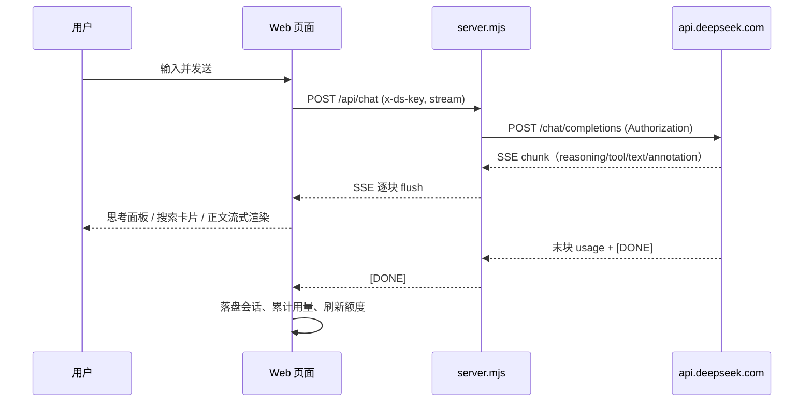
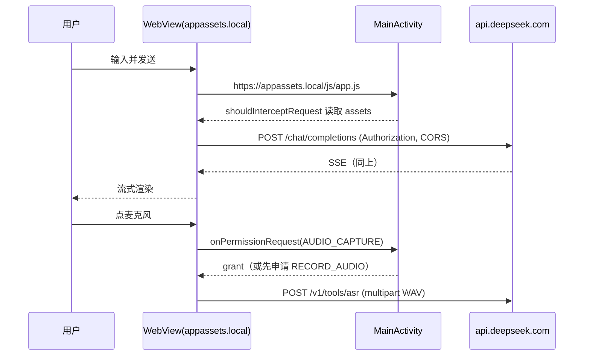
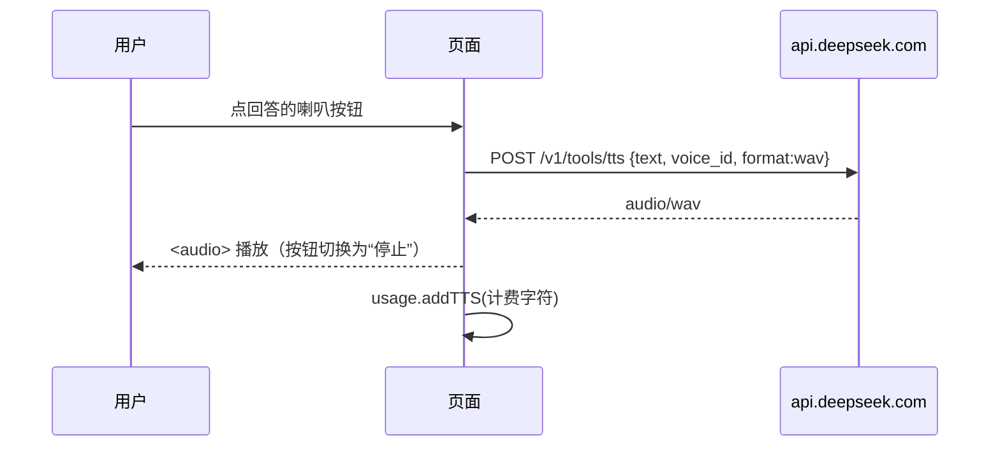
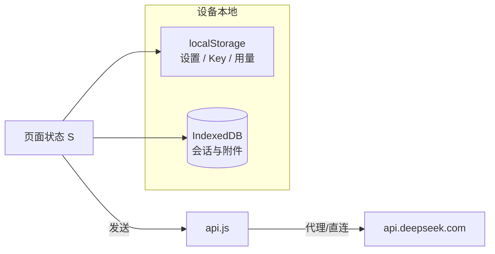

# 架构说明

> 读者对象：想改代码或排查链路的人。接口字段见 [API-MAPPING](API-MAPPING.md)。

## 总览

```text
┌────────────────────────── 手机 / 桌面 ──────────────────────────┐
│                                                                  │
│  Android APK                         浏览器 / PWA                │
│  ┌────────────────────────┐          ┌───────────────────────┐   │
│  │ WebView                │          │ 同一套静态页面         │   │
│  │ 源: https://appassets.local       │ 源: http(s)://局域网   │   │
│  │ assets 由 shouldInterceptRequest  │ fetch 同源 /api/*      │   │
│  └──────────┬─────────────┘          └──────────┬────────────┘   │
│             │ 直连 Authorization                │ 同源代理         │
└─────────────┼───────────────────────────────────┼────────────────┘
              │                                   ▼
              │                    ┌──────────────────────────────┐
              │                    │ server.mjs（Node，零框架）    │
              │                    │ 静态 + SSE 透传 + HTTPS + Mock│
              │                    └──────────────┬───────────────┘
              ▼                                   ▼
        ┌─────────────────────────────────────────────────┐
        │ api.deepseek.com（开放平台，按你的额度计费）       │
        └─────────────────────────────────────────────────┘
```

- **APK**：页面在安全上下文（`https://appassets.local`）里运行，麦克风可用；资源由壳拦截 assets 提供；请求带 `Authorization` 直连上游（平台支持 CORS），不依赖电脑。
- **浏览器 / PWA**：浏览器直连上游会被 CORS 拦、且非 HTTPS 不能用麦克风，所以由 `server.mjs` 同源转发并签发局域网证书。
- **GitHub Pages（可选）**：静态托管时页面走「网页直连」模式（`?direct=1` 或 `*.github.io` 自动识别），能力与 APK 一致，但不含本机代理。

## 三条请求链路（时序）

### 1. 浏览器对话（代理模式）



### 2. APK 对话（直连模式）



### 3. 朗读



## 模块地图

| 层 | 文件 | 职责 |
| --- | --- | --- |
| 入口 | `public/index.html` | 登录、主界面、输入区、侧栏、浮层容器 |
| 主控 | `public/js/app.js` | 登录、会话生命周期、发送/停止、语音、TTS、设置上下文、手势、PWA |
| API | `public/js/api.js` | 代理/直连双模式、SSE 解析、错误映射、TTS/ASR/Files |
| 对话 | `public/js/chat.js` | 请求组装、chunk 归一化、消息渲染、Mermaid、用量脚注 |
| 渲染 | `public/js/render.js` | Markdown/代码高亮/公式/引用角标（XSS 安全，零依赖） |
| 存储 | `public/js/store.js` | 设置、会话（IndexedDB）、导入导出 |
| 用量 | `public/js/usage.js` | token/缓存/TTS/ASR 累计与费用估算 |
| 语音 | `public/js/voice.js` | WAV 录音、降采样、TTS 播放器 |
| 搜索 | `public/js/search.js` | 独立 Search API 面板、网页阅读器 |
| 设置 | `public/js/settings.js` | 整页设置、二级页、系统提示词、用量页 |
| 侧栏 | `public/js/sidebar.js` | 分组、搜索、长按菜单 |
| 服务端 | `server.mjs` + `lib/*` | 静态、SSE 代理、安全头、限流、二维码、TLS |
| Mock | `mock/*` | 离线上游（SSE 全序列 + 工具端点） |
| APK 壳 | `android/app/src/.../MainActivity.java` | 资产拦截、权限、文件选择、导出、insets、返回键 |

## 数据与状态



- 会话结构：`{ id, title, model, thinking, webSearch, effort, messages[] }`
- 消息结构：`role/content/blocks/annotations/serverToolCalls/usage/durationMs/firstTokenMs`
- 渲染块：`think | tools | text`，引用按 URL 去重编号

## 边界与取舍

- **为什么 APK 不用代理**：平台支持 CORS，直连少一层、无端口、无电脑依赖；代价是 Key 存在 WebView 存储里。
- **为什么浏览器要代理**：CORS + 麦克风需要 HTTPS + 统一安全头与限流。
- **为什么用 Chat Completions**：见 [README 的协议说明](../README.md#5-计费说明)。
- **为什么零依赖**：便于审计与离线；代价是自研 Markdown/Mermaid 集成与手工 APK 工具链。
