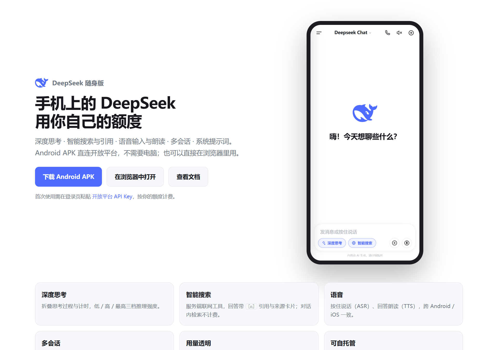

# 开发指南

## 1. 环境与启动

```bash
git clone https://github.com/nagatoquin33/deepseek-pocket.git
cd deepseek-pocket
npm install                 # 仅 qrcode 可选依赖

node server.mjs --mock      # 离线 Mock（8850 左右随机端口，终端会打印）
node server.mjs             # 真实上游（浏览器登录页粘贴 Key）
node server.mjs --https     # 局域网 HTTPS（语音输入必需）
npm test                    # 132 项单测
```

目录速览：

```text
server.mjs  lib/  mock/  test/        # 服务端与 Mock
public/{index.html,css,js,vendor,icons}
android/{app,build.ps1,build.sh}     # APK 工程与手工工具链
tools/{gen-cert,qa}                  # 证书、端到端与截图脚本
docs/                                # 本目录
```

## 2. 一次请求是怎么走的

1. `app.js#onSubmit` → `sendMessage` → 新建 user 消息、渲染气泡；
2. `chat.js#composeRequestBody` 组装 messages（含 `latest_reminder`、system prompt、tools、title）；
3. `api.js#chat` 流式请求（代理 `/api/chat` 或直连 `/chat/completions`）；
4. `chat.js#applyChunk` 把 chunk 归一化为 `think / tools / text` 块并节流渲染；
5. 结束：`afterAnswer` 落盘、累计用量、刷新余额、可选自动朗读。

改行为时优先找这三个函数：`composeRequestBody`、`applyChunk`、`renderMessageHTML`。

## 3. 调试

### 浏览器

- DevTools Network 看 `chat` 的 SSE 帧；Console 不应有 CSP 报错。
- `?demo=1&seed=1` 直接进入带示例会话的演示模式；`?direct=1` 强制直连上游。
- 本地 HTTPS 证书报错时删 `.tls/` 重新生成。

### Android APK

```bash
adb install -r android/dist/DeepSeekPocket-1.0.0.apk
adb logcat -s DeepSeekPocket chromium
# WebView 调试：chrome://inspect（壳内已开启 setWebContentsDebuggingEnabled）
adb shell am start -n com.deepseek.pocket/.MainActivity --ez demo true   # 离线演示
```

- 白屏先看 `adb logcat | grep -i intercept|asset`，多为 assets 未打进包；
- 麦克风：检查系统权限与 `onPermissionRequest` 日志。

### 服务端

- `node server.mjs --mock` 时所有请求不发外网，可断网联调；
- 401/402/429 会用本地假上游复现，不需要真实 Key。

## 4. 修改指南（常见任务）

| 想改 | 动哪里 | 别忘 |
| --- | --- | --- |
| 新增设置项 | `store.js` 默认值 → `settings.js` 行/二级页 → `composeRequestBody` 使用 | 迁移旧数据要一次性 |
| 新增渲染块 | `chat.js#applyChunk` 建块 → `renderAssistantBody` 渲染 | 补 XSS 测试 |
| 新增 API | `api.js` 路由表（代理 + 直连两条路径）→ `server.mjs` 白名单 | 直连要确认 CORS |
| 新增手势 | `app.js#bindUI` 的 touch 层 | 与系统返回手势冲突时让系统优先 |
| 改文案 | `index.html` / `settings.js` | 中英文与深色模式都要看 |

## 5. 测试与截图

```bash
npm test                     # 服务端 + 渲染器
npm run qa                   # 端到端（先起 --mock --port 8899）
npm run qa:voice             # 假麦克风 → ASR → 朗读按钮
npm run shots                # 生成 docs/screenshots（390×844）
```

- 渲染器改动必须补 `test/render.test.mjs`（XSS、表格、公式、围栏容错）。
- 服务端改动补 `test/server.test.mjs`（SSE、错误码、穿越、限流）。
- 截图命名 `NN-用途.png`，只提交文档引用的图。

## 6. 构建 APK

```bash
npm run build:android:win     # Windows（android/build.ps1）
npm run build:android         # Linux/macOS/CI（android/build.sh）
```

工具链：`aapt2 compile/link → javac → d8 → zip classes.dex → zipalign → apksigner`。
CI 见 [.github/workflows/build-apk.yml](../.github/workflows/build-apk.yml)，版本号跟随 tag。

## 7. 文档站

```bash
node tools/site/build.mjs     # 生成 site/（首页 + 文档静态页 + Web 版）
# 本地预览：npx serve site 或 python -m http.server -d site
```

文档源就是仓库里的 Markdown，站点构建复用 `public/js/render.js`，无需额外依赖。


